# Semaphore UI für Home Assistant (beta)

🇬🇧 [English version](README_en.md)

[](https://my.home-assistant.io/redirect/marketplace_repository/?owner=19Andy89&repository=ha_semaphoreui&category=integration)

Steuert [Semaphore UI](https://semaphoreui.com) (Ansible/Terraform/Bash-Templates) aus Home Assistant.
Pro Semaphore-**Projekt** ein Eintrag, pro **Template** ein Gerät – mit Status, Start/Testlauf/Stopp
und einem fertigen **Bericht**: was wann gestartet wurde, wie lange es lief, Ergebnis und – bei Fehlern – warum.
Zwei **Dashboard-Karten** (Template und Projekt) werden mitgeliefert und von der Integration selbst geladen.

Getestet mit Home Assistant 2026.10 (Browser-Test) und 2026.11 (im Alltagsbetrieb), dazu die jeweils aktuelle Version in der CI (siehe `tests/`); Mindestversion 2026.10.0, ältere Versionen sind nicht getestet. Läuft rein lokal, keine Cloud.

> **Inoffiziell:** Dieses Projekt ist ein unabhängiges Community-Projekt und steht in **keiner Verbindung** zu Semaphore UI
> und seinen Entwicklern; es wird weder von ihnen unterstützt noch empfohlen. Es nutzt ausschließlich die öffentliche
> REST-API einer Semaphore-Instanz. Ändert sich diese API, muss die Integration hier angepasst werden – Fehler bitte
> in **diesem** Repository melden, nicht beim Semaphore-Projekt.
> „Semaphore“ und „Semaphore UI“ sind Namen des jeweiligen Projekts und dienen hier nur dazu, zu benennen, womit die Integration spricht.
> Das Symbol ist das **Logo von Semaphore UI** (siehe [Symbol](#symbol-icon)); das Semaphore-UI-Projekt hat die Verwendung für diese
> inoffizielle Community-Integration erlaubt. Es macht sie nicht zu einem offiziellen Produkt.
> Das eigentliche Projekt: [semaphoreui/semaphore](https://github.com/semaphoreui/semaphore) ·
> [Webseite](https://semaphoreui.com) · [Dokumentation und API](https://docs.semaphoreui.com).

## So sieht es aus

Die Bilder entstehen im Browser-Test aus Beispieldaten (siehe [Tests](#tests)); Namen und Hosts sind erfunden.

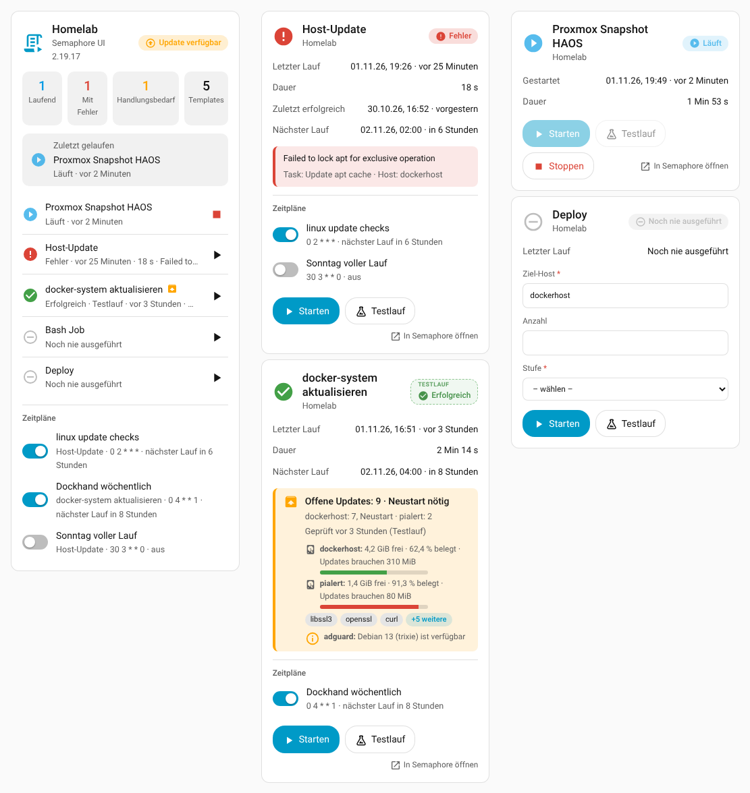

| Projekt-Karte | Template-Karte: Updates offen | Template-Karte: Fehler |
|---|---|---|
| 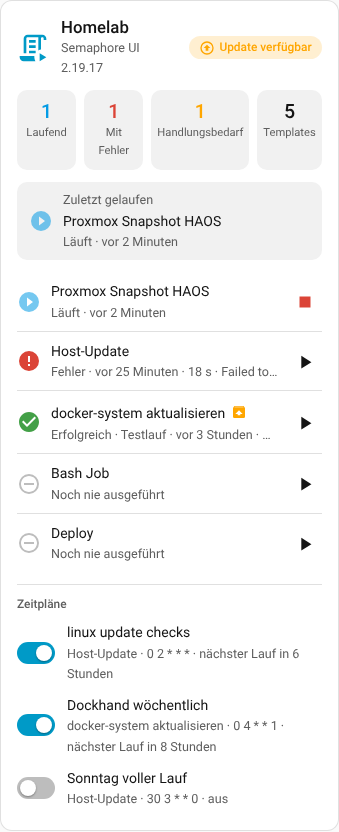 | 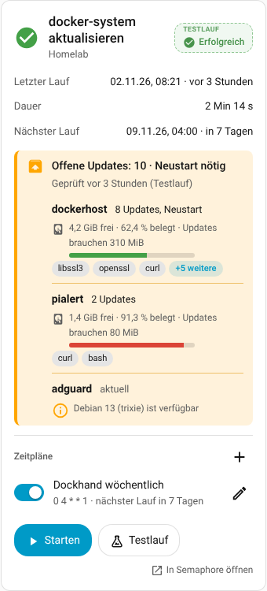 | 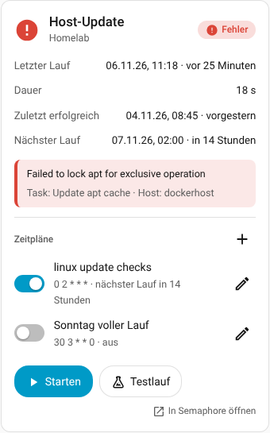 |

<details>
<summary>Dunkles Design, Smartphone, weitere Karten</summary>

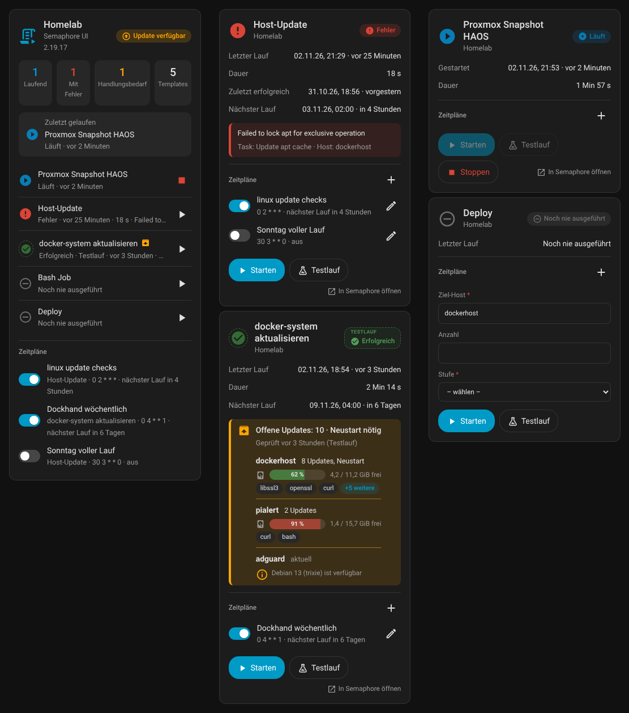

| Projekt-Karte, Smartphone, dunkel | Template-Karte, Smartphone, dunkel |
|---|---|
| 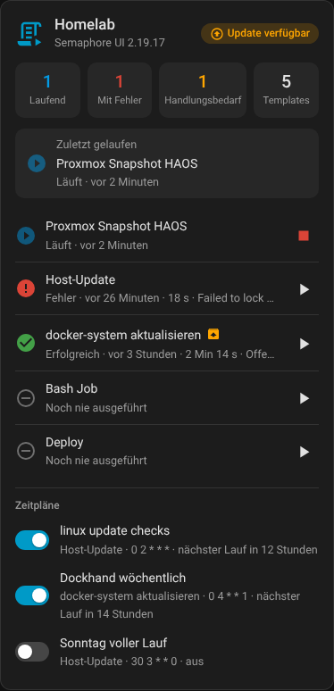 | 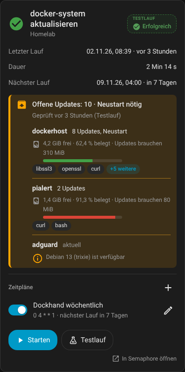 |

| Läuft gerade | Mit Survey-Eingaben | Versionen (Semaphore und Integration) | Nur, was gebraucht wird (`only_needed`) | Pakete aufgeklappt („+5 weitere“ angeklickt) |
|---|---|---|---|---|
| 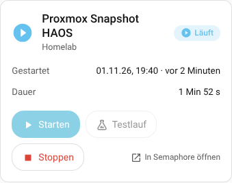 | 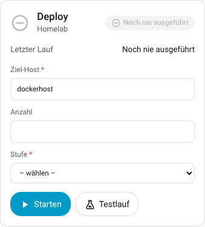 | 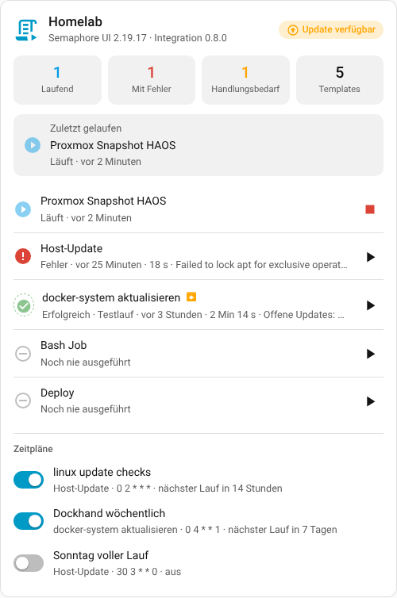 | 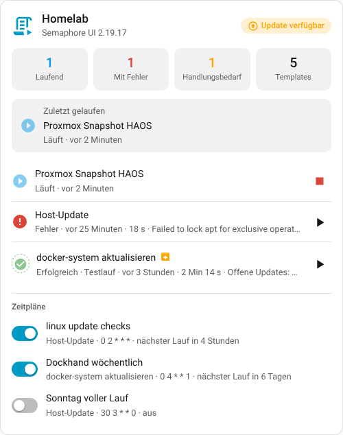 | 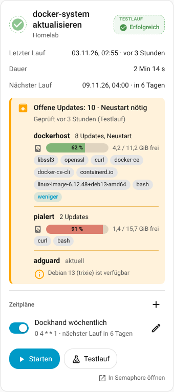 |

| Projekt-Karte: Eintrag aufgeklappt (Klick auf den Namen) |
|---|
| 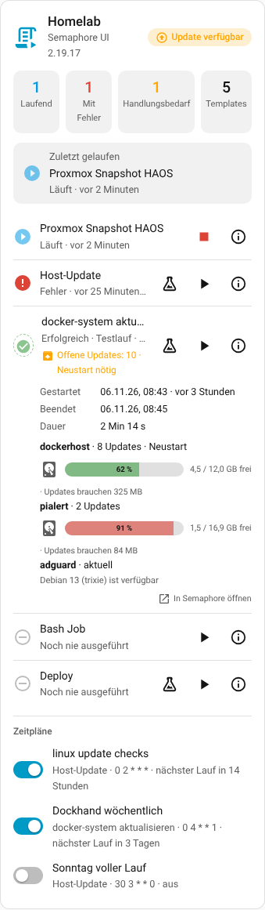 |

</details>

## Installation

**Über den Marketplace / HACS (empfohlen):** Den Badge oben anklicken („Open your Home Assistant instance …“) oder das Repository `19Andy89/ha_semaphoreui` als benutzerdefiniertes Repository (Kategorie *Integration*) hinzufügen, installieren und Home Assistant neu starten. Updates erscheinen dann wie bei anderen Integrationen; Vorabversionen (`-dev.N`) gibt es nur mit „Beta-Versionen anzeigen“.

**Von Hand:**

1. Ordner `custom_components/semaphore_ui` nach `/config/custom_components/semaphore_ui` kopieren.
2. Home Assistant neu starten.

Danach (beide Wege):

3. In Semaphore ein API-Token anlegen: Benutzername (oben rechts) → **API-Tokens** → **Neues Token**.
4. *Einstellungen → Geräte & Dienste → Integration hinzufügen → „Semaphore UI“*:
   URL (z. B. `https://semaphore.example.de`) + Token → danach das **Projekt** aus der Liste wählen.
   Das Token darf ein Ablaufdatum haben: Die Integration zeigt es an und erneuert das Token rechtzeitig
   (siehe [Token-Pflege](#token-pflege-ablauf-erneuern)).

Mehrere Projekte: Integration einfach mehrfach hinzufügen.
Die URL bitte so eintragen, wie sie ohne Weiterleitung erreichbar ist (`https://…`), sonst gehen POST-Aufrufe verloren.

## Geräte und Entitäten

### Projekt-Gerät „Semaphore – <Projektname>“

| Entität | Inhalt |
|---|---|
| Verfügbar (`binary_sensor`) | API erreichbar? Bleibt verfügbar und zeigt „aus“, auch wenn Semaphore offline ist |
| Semaphore-Update (`update`) | installierte Version vs. neueste Version (nur Anzeige, installiert nichts). Ein Build-Zusatz wie `2.19.17-f8cefe6-1792391878` wird ignoriert; die Rohfassung steht im Attribut `installed_version_reported` |
| Anzahl Templates | Zahl; Attribut `templates` = alle Namen |
| Laufende Tasks | wartende/laufende Tasks im Projekt. Attribute: `templates` (Namen der Templates, die gerade laufen), `task_ids`, `details` (je Template: `template`, `template_id`, `task_ids`, `status`, `dry_run`, `started`) – auch für Läufe, die in Semaphore selbst (Zeitplan, Weboberfläche) gestartet wurden |
| Template läuft (`binary_sensor`) | an, solange mindestens ein Task des Projekts wartet oder läuft; dieselben Attribute wie „Laufende Tasks“ – praktisch als Sichtbarkeits-Bedingung oder Automations-Auslöser („es läuft gerade etwas“) |
| Zuletzt gelaufenes Template | Name; Attribute = kompletter Bericht dieses Tasks |
| Status des letzten Laufs | `success`, `error`, `running`, … (Enum) |
| Letzter Lauf gestartet | Zeitstempel |
| Templates mit Fehler (Sensor + Problem-Sensor) | Anzahl bzw. an/aus. Attribute: `templates` (Namen), `explanation` (je Template eine Zeile: Template, Task-Nr., Zeit, Grund, fehlgeschlagener Schritt, Host), `failed_runs` (dieselben Angaben strukturiert, mit Link zum Task in Semaphore) |
| Templates mit Handlungsbedarf (Sensor) | Anzahl der Templates, deren letzter Lauf per `HA_RESULT` gemeldet hat, dass etwas zu tun ist (siehe [Handlungsbedarf](#handlungsbedarf-was-ist-gerade-zu-tun-ha_result)). Attribute: `templates`, `explanation` (je Template eine Zeile), `details` |
| Nächster geplanter Lauf (`sensor`, Zeitstempel) | wann der früheste **aktive Zeitplan** des Projekts das nächste Mal startet (siehe [Zeitpläne](#zeitpläne-schedules-von-semaphore)); unbekannt, wenn kein Zeitplan aktiv ist. Attribute: `schedule`, `template`, `timezone`, `schedules` (alle Zeitpläne mit `name`, `template`, `cron`, `active`, `next_run`, `entity_id` des Schalters) |
| Tasks (`event`) | feuert `started` / `success` / `failed` / `stopped`, Attribute = Bericht |

### Template-Gerät (eins pro Template)

Status · Zuletzt gestartet · Zuletzt beendet · Letzte Dauer · Zusammenfassung (Text, Attribute = Bericht) ·
Läuft · Letzter Lauf fehlgeschlagen (Attribute `reason`, `failed_task`, `host`, `task_id`, `url`, `explanation`, solange
der Fehler besteht) · Buttons **Starten**, **Testlauf** (nur Ansible-Templates), **Stoppen**.
Dazu – nur bei Templates, deren Playbook `HA_RESULT` ausgibt – **Handlungsbedarf** (an/aus) und **Offene Updates** (Zahl).
Bei jedem Template außerdem **Zuletzt erfolgreich** (Zeitstempel des Endes des letzten Laufs mit Status *success*; Attribute
`task_id`, `started`, `duration`, `dry_run` – ein erfolgreicher Testlauf zählt mit, `dry_run` sagt es). Endete der letzte Lauf nicht
erfolgreich, liest die Integration einmal den Verlauf dieses Templates, um den letzten Erfolg zu finden (auch nach einem Neustart
von Home Assistant). Und – nur bei Templates mit Zeitplan in Semaphore – **Nächster Lauf** (Zeitstempel, Attribute `schedule`,
`timezone`, `schedules`) und je Zeitplan ein **Schalter** (siehe [Zeitpläne](#zeitpläne-schedules-von-semaphore)).

**Kein Doppelstart:** Solange ein Lauf des Templates **wartet oder läuft**, sind **Starten** und **Testlauf** gesperrt (Karte,
Button und Aktion; **Stoppen** geht weiter). Die Aktion meldet dann „Template … läuft bereits oder wartet (Task …)“. Das gilt
auch für Läufe, die in Semaphore selbst gestartet wurden (Zeitplan, Weboberfläche) – sobald sie beim nächsten Abruf auftauchen
(Abfrage-Intervall, Standard 30 s). Der **Läuft**-Sensor liefert dazu die
Attribute `task_ids` (alle offenen Tasks) und `parallel_allowed` (`true`, wenn ein weiterer Start erlaubt wäre). Aufheben:
Option **Mehrfachstart erlauben** oder „Parallele Tasks“ am Template in Semaphore (dann gilt es nur für dieses Template).
In Automationen, die per Zeitplan einen Testlauf drücken, die Aktion mit `continue_on_error: true` ausführen oder vorher
prüfen, ob der **Läuft**-Sensor aus ist.

**Wann steht „Problem“ da?** Der Problem-Sensor des Projekts ist an, solange der **letzte Lauf mindestens eines Templates**
fehlgeschlagen ist – nicht nur der zuletzt gelaufene Task des Projekts. „Status des letzten Laufs“ kann also „success“
zeigen (ein anderes Template lief danach erfolgreich), während der Problem-Sensor an bleibt. Welches Template und warum,
steht im Attribut `explanation`. Der Sensor geht aus, sobald das Template erneut erfolgreich gelaufen ist.

Neue Templates erscheinen automatisch, gelöschte Geräte verschwinden automatisch.

### Survey-Variablen (Abfragen beim Start)

Hat ein Template Survey-Variablen, bekommt das Template-Gerät pro Variable eine **Eingabe-Entität** in der
Kategorie *Konfiguration*; Name = Titel der Variable, Standardwert = Default aus Semaphore.
Die Buttons **Starten** / **Testlauf** schicken genau diese Werte mit.

| Typ in Semaphore | Entität |
|---|---|
| String, Text | `text` |
| Integer | `number` (ganze Zahlen) |
| Enum | `select` (Beschriftung sichtbar, gesendet wird der Wert) |
| Select (Mehrfachauswahl), Secret | **keine Entität** (Secrets sollen nicht im Zustandsspeicher/Datenbank landen) – die **Karte** fragt sie beim Start in einem Dialog ab, sonst die Aktion |

Die Werte bleiben nach einem Neustart erhalten. Semaphores API prüft Pflichtfelder und Defaults nicht selbst
(das macht sonst die Weboberfläche) – deshalb macht es die Integration: fehlende Werte werden mit dem Default gefüllt,
ein Pflichtfeld ohne Wert, ein unbekannter Name oder ein ungültiger Wert bricht **vor** dem Start mit einer klaren
Meldung ab (z. B. `missing: stage, token (secret: only via the action)`).
Geänderte Variablen in Semaphore (neu, entfernt, neue Enum-Werte) werden automatisch übernommen.

**Dialog in der Template-Karte:** Hat ein Template Secrets oder Mehrfachauswahlen, öffnet *Starten* bzw. *Testlauf* in der Karte
statt sofort zu starten einen kleinen Dialog (Passwortfeld je Secret, Haken je Auswahlmöglichkeit, Vorgaben angehakt, Pflichtfelder
mit `*`). Erst *Starten* im Dialog startet (der Dialog ersetzt die Rückfrage von `confirm_start`). Die Werte der normalen
Eingabefelder der Karte gehen mit. Das Secret wird **nur** als Aktionsaufruf `semaphore_ui.run_template` (`survey`) an Home Assistant
und von dort als Secret an Semaphore gesendet – es steht in keinem Zustand und in keiner Entität und verschwindet mit dem Dialog.
(Wie jeder Aktionsaufruf läuft es kurz über den Ereignisbus von Home Assistant; Automationen, die auf `call_service` lauschen,
würden es sehen.) Welche Variablen der Dialog fragt, steht im Attribut `survey_dialog` der Start-Schaltfläche (ohne Vorgaben von Secrets).

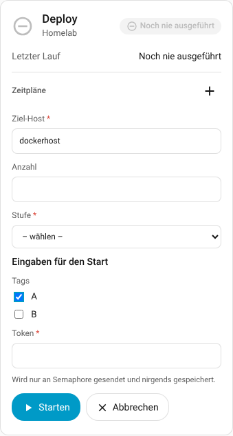

## Handlungsbedarf: „Was ist gerade zu tun?“ (`HA_RESULT`)

Damit Karten nur dann auftauchen, wenn sie gebraucht werden (z. B. „es gibt Updates“), muss die Integration wissen, **was
ein Testlauf gefunden hat**. Aus Ansible allein lässt sich das nicht ablesen: Die Zahlen im `PLAY RECAP` (`changed=…`)
sagen bei Host-Updates nichts darüber, ob Pakete anstehen. Deshalb gibt das Playbook am Ende **eine Zeile** aus:

```
HA_RESULT {"updates": 3, "reboot_required": false}
```

### In drei Schritten

1. **Baustein ans Ende des Playbooks** setzen (Ansible-Baustein weiter unten, für Debian/Ubuntu-Hosts fertig kopierbar). Er
   simuliert die Updates und gibt die `HA_RESULT`-Zeile aus. Bei Playbooks, die auch wirklich upgraden, gehört er **hinter**
   das Upgrade: Dann zeigt ein echter Lauf „0“, ein Testlauf die offenen Updates.
2. **Das Template einmal im Testlauf starten** (Knopf *Testlauf* in der Karte). Danach gibt es die Entitäten *Handlungsbedarf*
   und *Offene Updates* für dieses Template. Regelmäßig prüfen: siehe „Zeitpläne in Semaphore“ weiter unten.
3. **Anzeigen**: Die Template-Karte zeigt die Box „Offene Updates …“, die Projekt-Karte die Kachel „Handlungsbedarf“ (Klick =
   nur diese Templates). Für „Karte nur zeigen, wenn etwas zu tun ist“ eine Sichtbarkeits-Bedingung auf den Sensor setzen.

### Was die Integration daraus macht

Die Integration sucht diese Zeile im Log des **zuletzt beendeten Laufs** eines Templates (Testlauf oder echter Lauf – egal, wer
ihn gestartet hat, auch ein Zeitplan in Semaphore) und legt daraus pro Template an:

| Entität | Inhalt |
|---|---|
| **Handlungsbedarf** (`binary_sensor`) | an = Updates offen oder Neustart nötig; aus = nichts zu tun; *unbekannt* = der letzte Lauf hat nichts gemeldet (z. B. fehlgeschlagen). Attribute: `updates`, `installed`, `reboot_required`, `explanation`, `hosts` (je Host: `updates`, `installed`, `reboot_required`, `needed`, `notes`, `disk_free_mib`, `disk_required_mib`, `disk_used_percent`), `packages`, `notes`, `checked`, `checked_local`, `dry_run`, `task_id`, `url` |
| **Offene Updates** (`sensor`) | Zahl der offenen Updates (alle Hosts zusammen) |
| **Templates mit Handlungsbedarf** (Projekt-Sensor) | Anzahl; Attribut `templates` = Namen |

Die beiden Template-Entitäten gibt es nur für Templates, die `HA_RESULT` schon einmal gemeldet haben (danach bleiben sie
bestehen). Der Bericht (Ereignis, Antwort der Aktion, Zusammenfassung) enthält außerdem `ha_result`; der Push-Text bekommt
eine Zeile „Offene Updates: 3 · Neustart nötig“.

**Schlüssel des JSON-Objekts** (alle optional): `updates` (Zahl), `installed` (Zahl der in diesem Lauf installierten Updates; im Testlauf weglassen – die Karte zeigt dann „5 installiert“ und der Text „Offene Updates: 0“ entfällt), `reboot_required` (true/false), `packages` (Liste von Namen,
nur Anzeige, max. 50; die Karte zeigt sie in einer Zeile mit „+n weitere“), `host` (sonst der Host aus der Ansible-Ausgabe), `needed` (true/false – überschreibt die Regel),
`notes` (Text oder Liste von Texten, siehe unten; auch `note` wird gelesen).
**Platte des Hosts** (optional, nur Anzeige): `disk_free_mib` (freier Platz auf `/` in MiB), `disk_required_mib` (Platzbedarf der Updates in MiB)
und `disk_used_percent` (belegt, 0–100). Die Karten rechnen in MB/GB um (1 MiB = 1,048576 MB) und zeigen sie je Host als „4,5 / 12,0 GB frei · 62,4 % belegt · Updates brauchen 325 MB“ (der Bedarf nur, solange Updates offen sind)
mit einem Balken (ab 80 % orange, ab 90 % rot); Hosts ohne diese Werte bekommen keine Zeile. Sie ändern nichts am Handlungsbedarf.
Ungültige Werte (negativ, kein Zahlenwert, Prozent über 100) werden einzeln ignoriert. Das mitgelieferte `playbooks/update-linux.yml` meldet sie.
Unbekannte Schlüssel werden ignoriert. Ohne `needed` gilt: **Handlungsbedarf, wenn `updates` > 0 oder `reboot_required` wahr ist.** Bei mehreren Hosts zählt die
letzte Zeile je Host; die Zahlen werden addiert, ein Host mit Bedarf genügt.

**Wann ändert sich der Zustand?** Maßgeblich ist immer der **letzte beendete** Lauf. Während ein neuer Lauf wartet oder
läuft, bleibt das bisherige Ergebnis stehen. Endet der Lauf ohne `HA_RESULT` (oder fehlgeschlagen ohne Meldung), ist der
Zustand *unbekannt*. Deshalb den Baustein **ans Ende** des Playbooks setzen: Im Testlauf zeigt er die offenen Updates, nach
einem echten Lauf zeigt dieselbe Prüfung „0“. Kann das Log nicht gelesen werden (Semaphore antwortet nicht), versucht es
die Integration bei den nächsten Abfragen bis zu 5-mal erneut.

**Ansible-Baustein für Debian/Ubuntu-Hosts** (Pi-hole, LXC, Proxmox-Host …); getestet mit ansible-core 2.21, in den
Ausgabeformaten `yaml` und `json`, mit und ohne `--check`:

```yaml
    - name: Paketlisten aktualisieren (auch im Testlauf, damit die Simulation aktuell ist)
      ansible.builtin.apt:
        update_cache: true
        cache_valid_time: 3600
      check_mode: false
      become: true

    - name: Simulation - was würde installiert?
      ansible.builtin.command: apt-get -s dist-upgrade
      register: apt_sim
      changed_when: false
      check_mode: false          # die Simulation ändert nichts, darf also im Testlauf laufen

    - name: Neustart nötig?
      ansible.builtin.stat:
        path: /var/run/reboot-required
      register: reboot_flag

    - name: Ergebnis für Home Assistant melden
      ansible.builtin.debug:
        msg: >-
          HA_RESULT {{ {'updates': (apt_sim.stdout_lines | select('match', '^Inst ') | list | length),
                        'reboot_required': reboot_flag.stat.exists,
                        'packages': (apt_sim.stdout_lines | select('match', '^Inst ') | map('regex_replace', '^Inst (\S+).*$', '\1') | list)} | to_json }}
```

Das Template muss „Testlauf“ (`--check`) unterstützen; das Ergebnis erscheint, sobald der Lauf beendet ist. Soll ein Template
nie wegen eines ausstehenden Neustarts auffallen, lass `reboot_required` einfach weg.

**Hinweise (`notes`):** Mit `"notes": "Text"` oder einer Liste gibt das Playbook Hinweise mit, die **angezeigt, aber nicht als
Handlungsbedarf gezählt** werden – z. B. dass es eine neue Debian-Version gibt. Die Template-Karte zeigt bis zu 3 Hinweise (bei
mehreren Hosts mit dem Hostnamen, der Rest als „+ n weitere“), sie stehen im Attribut `notes` des Sensors *Handlungsbedarf*
und – bis zu 3 – als Zeilen „Hinweis (host): …“ im Push-Text. Je Lauf werden höchstens 10 Hinweise zu je 200 Zeichen
übernommen; doppelte entfallen.

**Wichtig – Reihenfolge:** `HA_RESULT` kann nur enthalten, was **vorher** berechnet wurde. Die Zeile gehört deshalb hinter alle
Prüfungen, die Hinweise liefern (auch hinter eine Debian-Prüfung). Beispiel: Der Hinweis „neue Debian-Version“ entsteht aus einem
Vergleich der installierten mit der aktuellen Stable-Version (`debian_stable_major` / `debian_stable_codename`, aus einer
Abfrage von `deb.debian.org/debian/dists/stable/Release`) und wandert dann in `notes`:

```yaml
    - name: Hinweis für Home Assistant vorbereiten      # erst NACH der Debian-Prüfung
      ansible.builtin.set_fact:
        debian_hinweis: >-
          Debian {{ ansible_facts.distribution_major_version }}
          ({{ ansible_facts.distribution_release }}) installiert,
          aktuell stabil ist Debian {{ debian_stable_major }}
          ({{ debian_stable_codename }})
      when:
        - ansible_facts.distribution == "Debian"
        - debian_stable_major is defined
        - (ansible_facts.distribution_major_version | int) < (debian_stable_major | int)

    - name: Ergebnis für Home Assistant melden          # ganz am Ende
      ansible.builtin.debug:
        msg: >-
          HA_RESULT {{ {
            'updates': (upgrade_final.stdout_lines | select('match', '^Inst ') | list | length),
            'reboot_required': reboot_required.stat.exists,
            'packages': (upgrade_final.stdout_lines | select('match', '^Inst ') | map('regex_replace', '^Inst (\S+).*$', '\1') | list),
            'notes': ([debian_hinweis] if debian_hinweis is defined else [])
          } | to_json }}
```

> **Die Playbooks im Ordner [`playbooks/`](playbooks/) sind Beispiele.** Sie enthalten keine Hosts, Zugangsdaten oder Adressen und zeigen, wie ein Playbook `HA_RESULT` meldet. Passe `hosts:` (Gruppe in deinem Inventar) und die Schwellenwerte an, und probiere sie zuerst als **Testlauf** (`--check`) aus. Für andere Aufgaben (Docker, Deploy, …) brauchst du ein eigenes Playbook mit einer `HA_RESULT`-Zeile; die Integration funktioniert auch ganz ohne (dann gibt es nur Status und Bericht, keinen Handlungsbedarf).

Ein vollständiges, getestetes Playbook (Speicherplatz-Prüfung, Update, Neustart-Prüfung, Debian-Prüfung, `HA_RESULT` mit
Hinweis) liegt unter [`playbooks/update-linux.yml`](playbooks/update-linux.yml); für **Proxmox-Hosts** (dist-upgrade, Neustartbedarf auch bei neuerem Kernel) gibt es [`playbooks/update-proxmox.yml`](playbooks/update-proxmox.yml); die Ausgabe im Format `yaml` und `json` ist
als Testfall hinterlegt.

**Läuft Semaphore selbst in Docker auf dem aktualisierten Host?** Ein Update von `docker-ce`/`containerd.io` startet den Docker-Dienst neu und beendet damit Semaphore samt laufendem Task (kein `HA_RESULT`, Lauf hängt oder schlägt fehl). `update-linux.yml` stellt solche Pakete deshalb zurück: Sie werden während des Laufs mit `apt hold` festgehalten, der Lauf endet normal und meldet sein Ergebnis, danach installiert ein von systemd gestarteter Job sie (nach 45 s; `deferred_upgrade_delay_seconds`). In der Meldung stehen sie als installiert und als Hinweis („Werden nach dem Lauf im Hintergrund installiert: docker-ce, …“). Die Liste steht in `deferred_upgrade_packages` (Standard: Docker-Pakete; leere Liste = alles im Lauf installieren). Im Testlauf wird nichts zurückgestellt, die Pakete zählen dort als offene Updates.

**Auch bei Fehlern melden:** Bricht eine Vorprüfung ab (zu wenig Platz, apt-Fehler), entstünde ohne Meldung nie ein Handlungsbedarf-Sensor
für den Host. Das mitgelieferte Playbook fasst die Vorprüfungen deshalb in einen `block`; im `rescue` gibt es
`HA_RESULT {"needed": true, "notes": ["Update nicht gestartet: …"], "disk_free_mib": …}` aus und lässt den Lauf danach mit `fail` scheitern.

**Dashboard:** In der Karte unter **Sichtbarkeit** eine Bedingung „Entität → Zustand“ auf den Sensor *Handlungsbedarf*
setzen (Zustand `Ein`) – die Karte erscheint nur, wenn etwas zu tun ist. Die Projekt-Karte kann alles in einer Liste
zeigen: Option `only_needed: true` blendet Templates ohne Handlungsbedarf, ohne Fehler und ohne laufenden Task aus.
In der Projekt-Karte klappt ein Klick auf ein Template dessen Details auf (Zeiten, Fehlergrund, Ergebnis je Host, Link zu Semaphore); More-Info öffnet das Info-Symbol rechts in der Zeile.
**Template-Karte nach dem Lauf noch 24 Stunden zeigen:** In den **Optionen** der Integration „Templates nach einem Lauf 24 Stunden sichtbar lassen“ einschalten.
Jedes Template hat dann den Diagnose-Sensor **Karte sichtbar** (`binary_sensor`, Attribute `reason` = `running` / `error` / `needs_action` / `recent`, `until`):
an, solange es läuft, fehlgeschlagen ist, Handlungsbedarf meldet oder – nur mit der Option – weniger als 24 Stunden her ist und nicht „Als erledigt markiert“ wurde.
Als Sichtbarkeitsbedingung der Karte „Entität → Zustand → Ein“ verwenden, oder in der Template-Karte den Haken **„Karte ausblenden, wenn nichts zu zeigen ist“** setzen
(`hide_when_idle: true`; im Bearbeitungsmodus bleibt die Karte sichtbar). Hat die Karte schon eine eigene **Sichtbarkeitsregel** (z. B. „Update verfügbar“), ergänzt der Haken **Sichtbarkeitsregel ergänzen** im Karten-Editor den Sensor per ODER – sonst bliebe die Karte während eines Laufs verborgen, weil Home Assistant die Regel selbst auswertet. Der Knopf **Als erledigt ausblenden** in der Karte (oder die Button-Entität *Als erledigt markieren*) beendet die Sichtbarkeit früher; ein neuer Lauf zeigt die Karte wieder.
Mit zusätzlich `show_recent: true` bleibt ein Template **24 Stunden nach seinem Lauf** sichtbar, auch wenn sonst nichts zu tun ist; ein Knopf (Auge) „Als erledigt ausblenden“ blendet es früher aus (Button-Entität *Als erledigt markieren*, gilt für alle Geräte; ein neuer Lauf blendet es wieder ein).
Für Updates, die Home Assistant selbst kennt (Core, OS, Supervisor, Container), genügt dieselbe Sichtbarkeits-Bedingung auf
die jeweilige `update`-Entität – dafür braucht es kein `HA_RESULT`.

**Regelmäßig prüfen:** Der Sensor ist nur so aktuell wie der letzte Lauf. Einen nächtlichen Testlauf startest du am
einfachsten mit einer Automatisierung in der Oberfläche (Auslöser *Zeit*, Aktion *Taste drücken* auf den Button *Testlauf*
des Templates) oder mit einem Zeitplan in Semaphore (siehe unten).

### Zeitpläne in Semaphore (Hinweise)

* **Cron-Ausdruck:** `0 2 * * *` startet **einmal um 02:00**. `* 2 * * *` dagegen läuft **jede Minute** zwischen 02:00 und 02:59.
* **Zeitzone:** Semaphore rechnet Zeitpläne standardmäßig in **UTC** – „02:00“ ist in Deutschland also 03:00 bzw. 04:00 Uhr.
  Ändern kannst du das beim Start von Semaphore mit der Umgebungsvariable `SEMAPHORE_SCHEDULE_TIMEZONE` (z. B. `Europe/Berlin`).
  Die Integration liest die Zeitzone aus Semaphore (`/api/info`) und rechnet „Nächster Lauf“ damit.
* **Testlauf per Zeitplan:** Die Zeitpläne in Semaphore (getestet mit 2.19.17) haben keine Testlauf-Option. Lege dafür ein
  **zweites Template** mit dem Playbook und den *Extra CLI Arguments* `["--check"]` an (z. B. „linux lxc prüfen“) und plane dieses;
  das Template ohne `--check` bleibt für das echte Aktualisieren.
* **Läufe aus Zeitplänen werden erkannt:** Maßgeblich ist der letzte beendete Lauf, egal wer ihn gestartet hat. Nach dem
  nächsten Abruf erscheint er in den Entitäten, in „Template läuft“ und in der Karte; solange er läuft, sind *Starten* und
  *Testlauf* gesperrt (Doppelstart-Schutz).
* Zeitpläne in Home Assistant anzeigen und ein-/ausschalten: siehe den nächsten Abschnitt.

## Zeitpläne (Schedules) von Semaphore

Zeitpläne laufen **in Semaphore** (Cron oder einmalig); Home Assistant zeigt sie an und schaltet sie ein/aus – so entscheidet
Semaphore selbst, wann etwas startet, und ein Neustart von Home Assistant ändert daran nichts.

* **Schalter je Zeitplan** (`switch`, am Gerät des Templates, Name „Zeitplan <Name>“): an = aktiv. Das Umschalten schickt nur das
  Kennzeichen `active` an Semaphore (`PUT /api/project/<id>/schedules/<id>/active` mit `{"active": true|false}`); Cron-Text,
  Template und alles andere bleiben unverändert. Die Anzeige springt sofort um, der nächste Abruf bestätigt es. In der Karte dreht sich währenddessen ein Kringel am Schalter,
  ein zweiter Klick wird ignoriert. Schaltest du dagegen direkt in Semaphore, kommt das bei Home Assistant mit dem nächsten Abruf
  an (Standard: alle 30 Sekunden, einstellbar unter *Optionen*). Schlägt der
  Aufruf fehl (z. B. fehlende Berechtigung des Tokens), steht der Grund in der Meldung von Home Assistant und der Schalter bleibt,
  wie er war. Schalter erscheinen und verschwinden mit den Zeitplänen in Semaphore.
* **Nächster Lauf** je Template und **Nächster geplanter Lauf** im Projekt (Zeitstempel). Die Integration rechnet den Cron-Text
  so, wie Semaphore es tut (Bibliothek `robfig/cron`, fünf Felder, `@daily` & Co., Monats- und Wochentagsnamen, Zeitzone von
  Semaphore oder ein `TZ=Europe/Berlin `-Präfix im Ausdruck). Einmalige Zeitpläne (`run_at`) zeigen ihren Zeitpunkt. Ausgeschaltete
  Zeitpläne und `@every …` (der Takt beginnt beim Laden in Semaphore und lässt sich nicht vorhersagen) haben keinen „nächsten Lauf“.
* **Karten:** die Template-Karte zeigt „Nächster Lauf“, „Zuletzt erfolgreich“ und die Schalter ihres Templates; die Projekt-Karte
  listet alle Zeitpläne des Projekts (der früheste zuerst, ausgeschaltete zuletzt). Option `show_schedules: false` blendet den
  Abschnitt aus.
* **Automationen:** Der Schalter ist ein normaler `switch` – z. B. „Zeitplan Linux-Updates nur an, wenn jemand zu Hause ist“.
* **Anlegen, ändern, löschen:** In der **Template-Karte** gibt es dafür ein „+“ an der Überschrift „Zeitpläne“ und je Zeitplan einen Stift. Es öffnet sich ein kleines Formular (Cron-Text, Name; Löschen fragt noch einmal nach). Unter dem Cron-Text steht beim Tippen, was er bedeutet („Täglich um 02:00 Uhr“, „Alle 2 Stunden ab 00:00 Uhr“, „Montags bis freitags um 06:00 Uhr“). Bei ungewöhnlichen Ausdrücken bleibt die Zeile leer. Beim Anlegen kann man auf **Einmalig** umschalten: Datum und Uhrzeit (Zeit des Browsers) statt Cron-Text, dazu „Nach dem Lauf löschen“. `edit_schedules: false` blendet beides aus. Die Projekt-Karte bleibt reine Anzeige. Die Karte nutzt diese Aktionen, du kannst sie auch selbst aufrufen:

  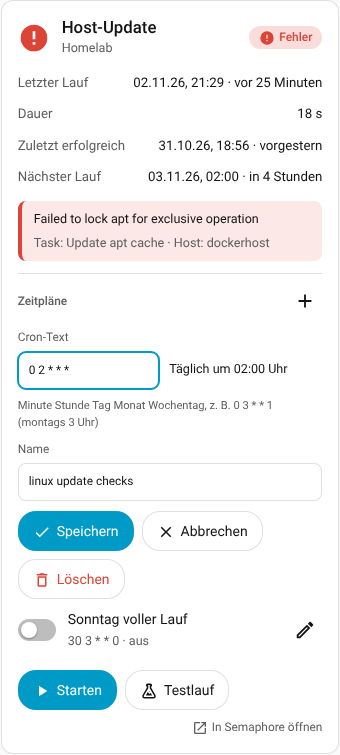

  * `semaphore_ui.create_schedule` – Ziel: das **Template-Gerät**; entweder `cron` (fünf Felder wie oben) **oder** `run_at` (einmalig, Datum und Uhrzeit in der Zeitzone von Home Assistant, wird als UTC an Semaphore gesendet), dazu `name` (Standard: Name des Templates), `active` (Standard: an), `delete_after_run` (Standard: aus). Antwort: `schedule_id` und `name`.
  * `semaphore_ui.update_schedule` – Ziel: der **Schalter** des Zeitplans; Felder `cron`, `run_at`, `name`, `template_id`, `active`, `delete_after_run`. Nicht genannte Felder bleiben unverändert; `cron` macht den Zeitplan wiederkehrend, `run_at` einmalig.
  * `semaphore_ui.delete_schedule` – Ziel: der **Schalter** des Zeitplans. Der Schalter verschwindet mit dem nächsten Abruf.

  Der Cron-Text wird vorher mit derselben Logik wie für „Nächster Lauf“ geprüft; ein Fehler steht dann klar in der Meldung, Semaphore wird nicht gefragt.
  Beim Ändern schickt die Integration den **ganzen** Zeitplan (`PUT /api/project/<id>/schedules/<id>`), weil Semaphore das so erwartet.
  Beispiel: `action: semaphore_ui.create_schedule` mit `target: {device_id: …}` und `data: {cron: "0 3 * * 1", name: "Montags"}`.
  Wie Semaphore einmalige Zeitpläne genau erwartet (`type: run_at`, Zeitstempel in `run_at`), ist aus dem Quellcode abgeleitet und noch nicht an einer echten Instanz geprüft.

## Dashboard-Karten

Die Integration liefert eine JavaScript-Datei mit zwei Karten aus und lädt sie selbst. Dafür gibt es zwei Wege, die
gleichzeitig genutzt werden: Sie wird mit der Oberfläche geladen **und** als Dashboard-Ressource eingetragen
(*Einstellungen → Dashboards → ⋮ → Ressourcen*, Eintrag `/semaphore_ui_static/semaphore-ui-card.js`, Typ „JavaScript-Modul“;
wird bei jedem Update aktualisiert). Du musst nichts eintragen. Steht `resources:` in deiner `configuration.yaml`
(YAML-Modus), bleibt diese Liste unangetastet; dann zusätzlich eintragen:
`- url: /semaphore_ui_static/semaphore-ui-card.js` / `type: module`.

Nach dem ersten Einrichten bzw. nach einem Update der Integration einmal Home Assistant neu starten und den Browser neu
laden (Strg+Shift+R, in der App: Cache leeren).

### So findest du die Karten

1. Dashboard öffnen → ✏️ **Bearbeiten** → in einem Abschnitt **＋ Karte hinzufügen**.
2. Der Dialog öffnet sich im Tab **„Nach Entität“** – dort erscheinen nur Entitäten. Wechsle zum Tab **„Nach Karte“**
   und suche nach **„Semaphore“**: „Semaphore UI – Template“ und „Semaphore UI – Projekt“.
3. Nach dem Klick ist schon das erste passende Gerät vorbelegt, rechts siehst du die Vorschau.

### Welches Gerät?

* **Template-Karte** → ein **Template-Gerät**. Die Auswahlliste zeigt nur diese, als **„Projekt › Template“**
  (z. B. „Homelab › Host-Update“), damit gleiche Namen in zwei Projekten unterscheidbar sind. Die Karte zeigt bei mehr
  als einem Projekt den Projektnamen unter dem Titel.
* **Projekt-Karte** → das **Projekt-Gerät** „Semaphore – <Projektname>“ (zeigt alle Templates dieses Projekts).
* Jede Karte hat ihr **eigenes** Gerät. Bei zwei Projekten (Homelab, Testlab) wählst du also je Karte das passende Projekt
  bzw. Template; es gibt keine globale Einstellung.
* In YAML: `device_id` ist die Geräte-ID (Editor → „Code-Editor anzeigen“). Ein falsches Gerät zeigt der Karte den Hinweis
  „Das ist kein passendes Semaphore-Gerät“.

### Template-Karte `custom:semaphore-ui-template-card`

Ein Template: Status-Chip (Farbe/Symbol, pulsiert während der Lauf aktiv ist), letzter Lauf (Datum und „vor 5 Minuten“),
Dauer (zählt live, solange der Task läuft), bei Fehlern der **Fehlergrund** mit Task und Host, die beim Start verwendeten
Parameter, die **Eingabefelder der Survey-Variablen** (Pflichtfelder mit `*`) sowie die Knöpfe **Starten**, **Testlauf**
(nur Ansible) und **Stoppen** (nur solange etwas läuft). Titel antippen = More-Info, „In Semaphore öffnen“ springt zum Task.
Meldet Semaphore beim Start einen Fehler (z. B. Pflicht-Survey-Wert fehlt), steht er direkt in der Karte.
War der letzte Lauf ein **Testlauf**, zeigt das Status-Kennzeichen oben rechts zweiteilig „Testlauf / Erfolgreich“ (bzw. „Fehler“) in hellerer Farbe mit gestricheltem Rand; die Projekt-Karte nennt es im Untertitel.
Gibt das Playbook `HA_RESULT` aus, zeigt die Karte eine Box „Offene Updates: 5 · Neustart nötig“ (mit Prüfzeit, Testlauf-Hinweis
und den Paketnamen) bzw. „nichts zu tun“. Die **Paketnamen stehen in einer Zeile**; was nicht hineinpasst, fasst „+5 weitere“
zusammen. Ein **Klick auf „+5 weitere“** zeigt alle Pakete (sie dürfen dann umbrechen), ein Klick auf „weniger“ klappt wieder zu –
auch per Tastatur (Enter/Leertaste). Wie viele Namen sichtbar sind, richtet sich nach der Breite der Karte (auch auf dem Handy). Bei **mehreren Hosts** steht darunter, wer wie viele hat
(„adguard: 5 · pialert: 6, Neustart“); **Hinweise** des Playbooks (`notes`) folgen darunter. Die Zeilen **Letzter Lauf** und
**Dauer** sowie der **Fehlertext** sind anklickbar: Ein Klick öffnet die Standard-Ansicht von Home Assistant (More-Info mit
Verlauf) des jeweiligen Sensors – auch per Tastatur (Enter/Leertaste). Hat das Template Zeitpläne, zeigt die Karte „Nächster Lauf“,
bei einem nicht erfolgreichen letzten Lauf auch „Zuletzt erfolgreich“, und darunter die **Zeitpläne mit Schalter** (Name, Cron-Text,
nächster Lauf; ein Klick auf den Namen öffnet die Standard-Ansicht des Schalters).
Nach einem Klick auf **Starten**, **Testlauf**, **Stopp** oder einen Zeitplan-Schalter dreht sich ein **Kringel**, bis Semaphore
geantwortet hat – so ist klar, dass der Klick angekommen ist; ein zweiter Klick in dieser Zeit wird ignoriert (Projekt-Karte: ebenso
bei Start und Stopp in der Liste).

```yaml
type: custom:semaphore-ui-template-card
device_id: 0123456789abcdef0123456789abcdef   # Template-Gerät (im Editor auswählen)
name: Docker-Stacks aktualisieren              # optional
show_survey: true                              # Eingabefelder der Survey-Variablen (Standard: true)
show_details: true                             # Fehlergrund + Parameter (Standard: true)
confirm_start: true                            # „Wirklich starten?“ vor dem Start (Standard: false)
show_schedules: true                           # Zeitpläne mit Schalter (Standard: true)
edit_schedules: true                           # „+“ und Stift: Zeitpläne in der Karte anlegen, ändern, löschen (Standard: true)
```

### Projekt-Karte `custom:semaphore-ui-project-card`

Das ganze Projekt auf einen Blick: Name, Semaphore-Version (abschaltbar) und Hinweis „Update verfügbar“, Warnleiste wenn
Semaphore nicht erreichbar ist, Zähler (laufend / mit Fehler / Handlungsbedarf / Templates), der **zuletzt gelaufene Task** mit
Status, Zeit und Dauer und die Liste **aller Templates** (laufende, fehlerhafte und solche mit Handlungsbedarf zuerst) mit
Kurzinfo je Zeile und **Start-/Stopp-Knopf**. Die Kachel „Handlungsbedarf“ erscheint, sobald ein Template `HA_RESULT` meldet.

* **Die Kacheln sind Filter:** Ein Klick auf *Läuft*, *Mit Fehler* oder *Handlungsbedarf* zeigt nur die betroffenen Templates
  (hervorgehoben); nochmal antippen oder die Kachel *Templates* zeigt wieder alle. Gibt es keinen Treffer, steht ein kurzer
  Hinweis („Gerade läuft nichts.“). Der Filter gilt nur für die angetippte Karte und nur, solange die Seite offen ist.
* **Versionen:** `show_version` blendet die Semaphore-Version ein/aus (Standard: an), `show_integration_version` zeigt dahinter
  die Version der Integration („Semaphore UI 2.19.17 · Integration 0.1.5“, Standard: aus). Wählst du bei
  `hacs_update_entity` die `update`-Entität der Integration aus HACS, kommt deren installierte Version in die Zeile und ein
  Hinweis „Integration-Update“, sobald HACS ein Update meldet (Klick öffnet die Update-Entität). Ohne Auswahl entfällt der Hinweis.
* Mit `templates` (siehe unten) lässt sich die Liste auf einzelne Template-Geräte beschränken – die Kacheln zählen weiter das ganze Projekt.
* **Zeitpläne:** Unter der Liste stehen alle Zeitpläne des Projekts mit Schalter, Template, Cron-Text und nächstem Lauf
  (`show_schedules: false` blendet sie aus; die Zeitzone von Semaphore steht als Hinweis an der Überschrift).

```yaml
type: custom:semaphore-ui-project-card
device_id: 0123456789abcdef0123456789abcdef   # Projekt-Gerät
name: Homelab                                  # optional
sort: status                                   # status | name | last_run
show_never_run: true                           # Templates ohne Lauf zeigen
only_needed: false                             # true = nur Templates mit Handlungsbedarf, Fehler oder laufendem Task
show_recent: false                             # true (mit only_needed) = zusätzlich Templates der letzten 24 h, mit Ausblenden-Knopf
show_start: true                               # Start-Knopf je Zeile
confirm_start: false                           # Rückfrage vor dem Start
show_version: true                             # Semaphore-Version in der Kopfzeile
show_integration_version: false                # Version der Integration dahinter
hacs_update_entity: update.semaphore_ui        # optional: Update-Entität der Integration aus HACS (Hinweis „Integration-Update“)
show_schedules: true                           # Zeitpläne des Projekts mit Schaltern
templates: []                                  # optional: nur diese Template-Geräte (device_id) zeigen
```

Beide Karten passen sich an Hell/Dunkel, schmale Bildschirme und das Sections-Layout an, sind per Tastatur bedienbar
und folgen der Sprache von Home Assistant (Deutsch/Englisch). Eingabefelder werden nicht überschrieben, solange du darin tippst.

## Der Bericht (JSON)

Gleicher Aufbau in den Ereignissen, in der Aktions-Antwort und in den Attributen der Zusammenfassungs-Sensoren.
`title` und `text` sind fertig für Push-Nachrichten.

```json
{
  "project": "Homelab", "project_id": 1,
  "template": "docker-system aktualisieren", "template_id": 1,
  "task_id": 42,
  "status": "error",            // Semaphore-Status: waiting, starting, running, success, error, stopped, …
  "result": "failed",           // vereinfacht: success | failed | stopped | running | queued | never_run
  "success": false,             // true / false / null (noch nicht fertig)
  "finished": true,
  "dry_run": false,
  "started_by": "Andreas",
  "note": null,
  "parameters": { "target": "dockerhost", "stage": "test" },   // Survey-Werte des Starts (nie Secrets)
  "created": "2026-10-24T12:00:00+00:00",
  "started": "2026-10-24T12:00:00+00:00",
  "ended": "2026-10-24T12:00:03+00:00",
  "started_local": "24.10.2026 14:00:00",
  "ended_local": "24.10.2026 14:00:03",
  "duration_seconds": 3,
  "duration": "3 s",
  "error": {
    "reason": "Error when processing /home/x/docker-system: pull access denied",
    "failed_task": "Neue Images ziehen, Container mit neuem Image neu erstellen",
    "host": "dockerhost",
    "kind": "failed"            // failed | unreachable | error
  },
  "recap": [ { "host": "dockerhost", "ok": 0, "changed": 0, "unreachable": 0, "failed": 1 } ],
  "output_tail": [ "…die letzten 8 Zeilen des Logs…" ],
  "ha_result": null,            // nur wenn das Playbook HA_RESULT ausgibt, siehe „Handlungsbedarf“:
                                // {"needed": true, "updates": 3, "reboot_required": false, "hosts": {…}, "packages": [...]}
  "url": "https://semaphore.example.de/project/1/templates/1?t=42",
  "title": "❌ docker-system aktualisieren: fehlgeschlagen",
  "text": "Gestartet: 24.10.2026 14:00:00 (von Andreas)\nDauer: 3 s\nErgebnis: fehlgeschlagen\n• dockerhost: 1 fehlgeschlagen\nFehler: Error when processing /home/x/docker-system: pull access denied\nTask: Neue Images ziehen, Container mit neuem Image neu erstellen\nHost: dockerhost",
  "short": "❌ fehlgeschlagen · 3 s · 24.10. 14:00 · Error when processing …"
}
```

Der Fehlergrund wird aus dem Ansible-Log gelesen (`fatal: … FAILED!/UNREACHABLE!` inkl. `msg`/`stderr`,
sonst `ERROR!`/`[ERROR]:`; sowohl im `json`- als auch im `yaml`-Ausgabeformat von Ansible); bei anderen Apps (Bash, Terraform) stehen die letzten Log-Zeilen in `output_tail`.
Sprache der Texte = Sprache von Home Assistant (Deutsch/Englisch).

## Push bei jedem Taskende

Bus-Ereignisse: `semaphore_ui_task_started` und `semaphore_ui_task_finished`
(auch für Tasks, die in der Semaphore-Oberfläche oder per Zeitplan gestartet wurden – Erkennung beim nächsten Abruf,
während ein Task läuft alle 5 s). Beim Start von Home Assistant werden alte Ergebnisse **nicht** erneut gemeldet.

### Fertiges Blueprint (empfohlen)

Ohne YAML: Das Blueprint **„Semaphore UI – Benachrichtigung bei Taskende“** legt die Automation für dich an. Importieren:

[](https://my.home-assistant.io/redirect/blueprint_import/?blueprint_url=https%3A%2F%2Fgithub.com%2F19Andy89%2Fha_semaphoreui%2Fblob%2Fmain%2Fblueprints%2Fautomation%2Fha_semaphoreui%2Fsemaphore_task_result.yaml)

(oder *Einstellungen → Automatisierungen & Szenen → Blueprints → Blueprint importieren* mit
`https://github.com/19Andy89/ha_semaphoreui/blob/main/blueprints/automation/ha_semaphoreui/semaphore_task_result.yaml`). Danach *Automation erstellen* und wählen:

* **Benachrichtigen:** eine oder mehrere `notify`-Entitäten (z. B. dein Handy).
* **Wann:** *nur bei Fehlern*, *bei Fehlern und bei Handlungsbedarf* (auch erfolgreiche Läufe mit `HA_RESULT` `needed: true`) oder *bei jedem Ergebnis*.
* **Auch bei offenen Updates benachrichtigen** (Standard: aus): meldet jeden Lauf, nach dem noch Updates offen sind, unabhängig von „Wann“. Mit „Nur bei Fehlern“ kombiniert kommt also kein Hinweis nur wegen eines nötigen Neustarts.
* **Auch Läufe ohne HA_RESULT melden** (Standard: an): Läufe von Playbooks ohne `HA_RESULT` (z. B. Build/Deploy) melden sich mit einer kurzen Nachricht (Ergebnis, Dauer, eine Zeile pro Host) statt gar nicht.
* **Testläufe einbeziehen** (Standard: ja), **nur bestimmte Templates** (Namen wie in Semaphore) und **zusätzliche Aktionen** (der Bericht steht in `trigger.event.data`).

**Blueprint aktuell halten:** Am Gerät des Projekts gibt es die Entität **Blueprint-Update** (zeigt die installierte und die neueste Version, Knopf *Installieren*) und den Knopf **Blueprint herunterladen** (lädt die Datei aus dem neuesten Release, auch wenn sie schon aktuell ist). Die Datei landet in `/config/blueprints/automation/19Andy89/semaphore_task_result.yaml`, also dort, wo auch der Import-Dialog sie ablegt; bestehende Automationen nutzen sie weiter und werden neu geladen. Eine vorhandene, abweichende Datei bleibt als `semaphore_task_result.yaml.bak` erhalten. Die installierte Version steht als Kommentar in der ersten Zeile; eine von Hand importierte Datei gilt als aktuell, wenn ihr Inhalt dem Release entspricht, sonst als „unknown“. Auf einer **Dev-Version** der Integration (`…-dev.N`) zählt auch das neueste Vorab-Release, du bekommst dann also auch die Dev-Blueprints; mit einer stabilen Version nur stabile. Geprüft wird alle 6 Stunden (abschaltbar mit „Auf neue Semaphore-Version prüfen“ in den Optionen; der Knopf lädt dann trotzdem auf Wunsch).

Titel und Text kommen fertig aus der Integration. Ein nächtlicher Testlauf mit offenen Updates meldet bei „Handlungsbedarf“
jede Nacht, bis sie installiert sind; dafür gibt es den Filter nach Templates oder die Einstellung „nur bei Fehlern“.

### Selbst bauen

Per UI: *Automation → Auslöser „Ereignis“ → `semaphore_ui_task_finished`*, Aktion „Benachrichtigung senden“ mit
`{{ trigger.event.data.title }}` / `{{ trigger.event.data.text }}`. Als YAML:

```yaml
alias: Semaphore – Ergebnis als Push
description: ""
triggers:
  - trigger: event
    event_type: semaphore_ui_task_finished
conditions: []   # nur Fehler: - condition: template / value_template: "{{ trigger.event.data.result == 'failed' }}"
actions:
  - action: notify.mobile_app_iphone11
    data:
      title: "{{ trigger.event.data.title }}"
      message: "{{ trigger.event.data.text }}"
      data:
        url: "{{ trigger.event.data.url }}"
        push:
          thread-id: semaphore
mode: queued
```

Alternativ ohne YAML-Ereignisnamen: Auslöser „Entität“ → *Tasks* (Event-Entität) „hat ein Ereignis empfangen“;
der Bericht steht dann in den Attributen (`trigger.to_state.attributes.title` / `.text`).

## Aktion `semaphore_ui.run_template`

Ziel: das **Template-Gerät** (nicht das Projekt-Gerät).

| Feld | Standard | Bedeutung |
|---|---|---|
| `dry_run` | `false` | Testlauf (`--check`) |
| `wait` | `false` | auf das Ende warten; Antwort = fertiger Bericht |
| `timeout` | `600` | max. Wartezeit in Sekunden (danach Zwischenstand, `timed_out: true`) |
| `message` | – | Notiz am Task in Semaphore |
| `limit` | – | nur diese Hosts (`--limit`) |
| `survey` | – | Werte der Survey-Variablen als `name: wert` (siehe unten) |
| `raise_on_failure` | `false` | bei Fehler Aktion mit Fehler beenden (bricht ein Skript ab) |
| `build_version` / `build_task_id` | – | nur **Deploy-Templates**: welcher erfolgreiche Build ausgerollt wird (Version wie `1.0.12` oder Task-Nummer; nur eins von beiden) |

**Build- und Deploy-Templates:** Ein *Build*-Template bekommt seine Version von Semaphore selbst und startet wie jedes andere. Ein *Deploy*-Template
rollt einen fertigen Build aus: ohne Angabe nimmt die Integration den **neuesten erfolgreichen Build** seines Build-Templates
(Start-Taste, Karte und Aktion), mit `build_version` oder `build_task_id` einen bestimmten. Gibt es noch keinen erfolgreichen Build oder
keinen mit dieser Version, meldet die Aktion das klar, statt etwas zu starten. Die Felder stammen aus dem Semaphore-Quellcode
(`build_task_id`, `version`, `build_template_id`); an einer echten Instanz mit Build-/Deploy-Templates ist das noch nicht geprüft.

Survey-Werte: die Aktion nutzt **nur** die Werte aus `survey` plus die Defaults aus Semaphore – nicht die Eingabe-Entitäten
(damit eine Automation nie versehentlich einen alten Wert aus dem Dashboard verwendet). Enum: Wert **oder** Beschriftung,
Select: Liste (oder kommagetrennt), Integer: Zahl, Secret: Text (taucht nie im Bericht auf).

```yaml
sequence:
  - action: semaphore_ui.run_template
    target:
      device_id: DEIN_TEMPLATE_GERAET
    data:
      wait: true
      timeout: 900
      survey:
        target: dockerhost
        stage: Test
        tags: [a, b]
        token: !secret semaphore_deploy_token
    response_variable: ergebnis
  - action: notify.mobile_app_iphone11
    data:
      title: "{{ ergebnis.title }}"
      message: "{{ ergebnis.text }}"
```

## Optionen (Zahnrad am Eintrag)

* Abfrage-Intervall (Standard 30 s; während ein Task läuft automatisch 5 s)
* Live-Updates (Standard: an) – solange ein Task läuft, hält Home Assistant eine WebSocket-Verbindung zu Semaphore (`/api/ws`) offen:
  Status und der gerade laufende Ansible-Schritt („Schritt 7: Paketlisten aktualisieren“, Attribut `current_step` am Status-Sensor
  und Zeile in der Template-Karte) erscheinen sofort. Ohne laufenden Task besteht keine Verbindung; fällt sie aus oder kennt
  die Semaphore-Version `/api/ws` nicht, wird einfach weiter abgefragt.
* Auf neue Semaphore-Version prüfen (fragt alle 6 Std. die GitHub-Releases ab; ohne Token; dazu alle 6 Std. die Release-Prüfung des Blueprints in diesem Repository)
* Mehrfachstart erlauben (Standard: aus) – hebt die Sperre gegen einen zweiten Start auf, solange für ein Template schon ein
  Lauf wartet oder läuft (siehe [Template-Gerät](#template-gerät-eins-pro-template))
* **Templates in Home Assistant anzeigen** – Liste aller Templates des Projekts, alle angehakt. Abgewählte Templates bekommen
  **keine Geräte, Entitäten und Zeitplan-Schalter**; ihre vorhandenen Geräte werden beim Speichern entfernt. Gut für Templates,
  die nur in Semaphore gebraucht werden (z. B. Build-Jobs). Gemerkt werden die **abgewählten**: ein neues Template in Semaphore
  erscheint also weiter von selbst. Mindestens eines muss angehakt bleiben. Dashboard-Karten abgewählter Templates zeigen danach
  ein fehlendes Gerät und können gelöscht werden. Die Zähler der Projekt-Karte (Templates, Handlungsbedarf, …) und „Nächster
  geplanter Lauf“ gelten nur für die angehakten Templates; der Zähler „Anzahl Templates“ nennt die weggelassenen im Attribut
  `excluded`. Ist Semaphore beim Öffnen der Optionen nicht erreichbar, fehlt die Liste; die gespeicherte Auswahl bleibt dann erhalten.
* **API-Token vor dem Ablauf selbst erneuern** (Standard: an), **Tage vor dem Ablauf** (Standard 7), optional **Benutzer und Passwort
  für den Notfall** – siehe [Token-Pflege](#token-pflege-ablauf-erneuern).

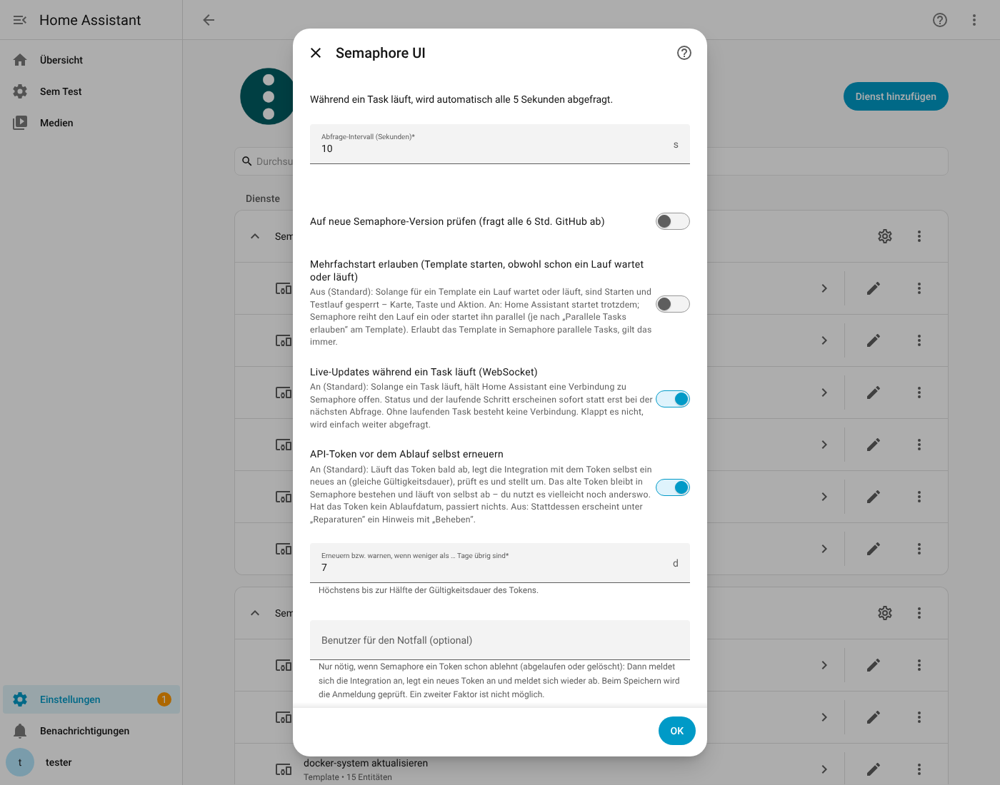

## Fehler bei der Einrichtung

Schlägt die Einrichtung (oder „Neu konfigurieren“ / „Erneut authentifizieren“) fehl, steht die **Ursache direkt im
Dialog** – das Log wird nicht gebraucht: Name nicht auflösbar (DNS), Verbindung abgelehnt (Port), Zeitüberschreitung,
Zertifikatsfehler, Rechner nicht erreichbar, ungültige Adresse, „unter dieser Adresse antwortet kein Semaphore“ (mit
HTTP-Status), abgelehntes Token (401), Projekt nicht gefunden. Das Token steht nie in einer Meldung oder im Log.

## Reparaturen (Einstellungen → Reparaturen)

Probleme, die du beheben musst, meldet die Integration unter **Einstellungen → System → Reparaturen**. Je Projekt gibt es
höchstens einen Hinweis pro Art, und er verschwindet von selbst, sobald das Problem weg ist.

| Hinweis | Wann | Was tun |
|---|---|---|
| **Semaphore: API-Token abgelehnt** | sofort, wenn Semaphore das Token ablehnt (HTTP 401) und kein gespeicherter Login hilft | **Beheben**: neues Token **oder Benutzer und Passwort** eintragen. Es wird geprüft, bevor es gespeichert wird; danach lädt die Integration neu und die offene Meldung „Erneut authentifizieren“ ist erledigt. |
| **Semaphore: API-Token läuft bald ab** | wenn das Token in weniger als den eingestellten Tagen abläuft **und** die automatische Erneuerung aus ist | **Beheben**: legt mit dem aktuellen Token ein neues an, prüft und übernimmt es. |
| **Semaphore: API-Token konnte nicht erneuert werden** | wenn die automatische Erneuerung fehlgeschlagen ist (der Grund steht im Hinweis) | **Beheben** versucht es erneut; sonst in Semaphore ein Token anlegen und unter „Erneut authentifizieren“ eintragen. |
| **Semaphore ist nicht erreichbar** | wenn Semaphore **10 Minuten ohne Unterbrechung** nicht antwortet (Verbindung, Zeitüberschreitung, HTTP 5xx, falsche Antwort) | Semaphore, Adresse, Netzwerk und Firewall prüfen. Der Hinweis nennt den Grund und seit wann es besteht. Ein Neustart von Semaphore (ein paar Sekunden) löst nichts aus. |
| **Semaphore-Projekt nicht gefunden** | wenn das Projekt **10 Minuten** lang HTTP 404/403 liefert | Projekt in Semaphore und Rechte des Tokens prüfen; wurde das Projekt gelöscht, den Eintrag entfernen. |

Solange ein Problem besteht, sind die Geräte und Entitäten des Projekts „nicht verfügbar“ (die Zeitpläne und Läufe in Semaphore
laufen unabhängig davon weiter). Die Hinweise werden nicht gespeichert: Nach einem Neustart von Home Assistant zählen die
10 Minuten neu, ein abgelehntes Token wird sofort wieder gemeldet. Wird der Eintrag entfernt, verschwinden auch seine Hinweise.

## Symbol (Icon)

`custom_components/semaphore_ui/brand/` enthält das **Logo von Semaphore UI** ([semaphoreui.com](https://semaphoreui.com)). Das
Semaphore-UI-Projekt hat erlaubt, es in diesem Repository und in der HACS-Liste zu verwenden, solange klar ist, dass dies eine
**inoffizielle Community-Integration** ist und auf semaphoreui.com verwiesen wird – beides steht oben in dieser Datei. Das Logo gehört
dem Semaphore-UI-Projekt (siehe `brand/LICENSE.txt`); die Erlaubnis gilt nicht automatisch für Dritte, die dieses Repository kopieren.
Quelle: `brand/icon.svg`; Home Assistant 2026.10 lädt `brand/icon.png` und `brand/icon@2x.png` direkt aus der Integration.

## Token-Pflege (Ablauf, erneuern)

Ab Semaphore 2.18.2 können API-Tokens ein **Ablaufdatum** haben. Die Integration liest es einmal pro Stunde
(`GET /api/user/tokens`, das eigene Token erkennt sie an den ersten 8 Zeichen) und zeigt es an:

* **Sensor „API-Token gültig bis“** (Diagnose, am Projekt-Gerät, Zeitstempel). Attribute: `token_found`, `token_name`, `created`,
  `never_expires`, `auto_renew`, `renew_days_before`, `stored_login`, `last_renewed`, `renew_error`. Hat das Token kein Ablaufdatum
  (oder zeigt Semaphore die Tokens nicht), bleibt der Sensor leer und es passiert nichts.
* **Automatisch erneuern** (Option, Standard an): Bleiben weniger als **7 Tage** (einstellbar, höchstens die halbe Gültigkeitsdauer),
  legt die Integration **mit dem Token selbst** ein neues an (`POST /api/user/tokens`, gleiche Gültigkeitsdauer, Name
  „Home Assistant (semaphore_ui)“), prüft es mit einer Abfrage und stellt dann um. **Kein Passwort nötig.**
  Das **alte Token wird nicht gelöscht**: Du nutzt es vielleicht noch anderswo (`rest_command`, Skripte), und es läuft von selbst ab.
  Neue Tokens sammeln sich daher in Semaphore (unter „API-Tokens“); alte kannst du dort jederzeit selbst löschen.
* **Erneuerung aus:** Dann erscheint unter *Reparaturen* der Hinweis „API-Token läuft bald ab“ mit **Beheben** (ein Klick erneuert).
  Schlägt die automatische Erneuerung fehl, steht der Grund im Hinweis „konnte nicht erneuert werden“.

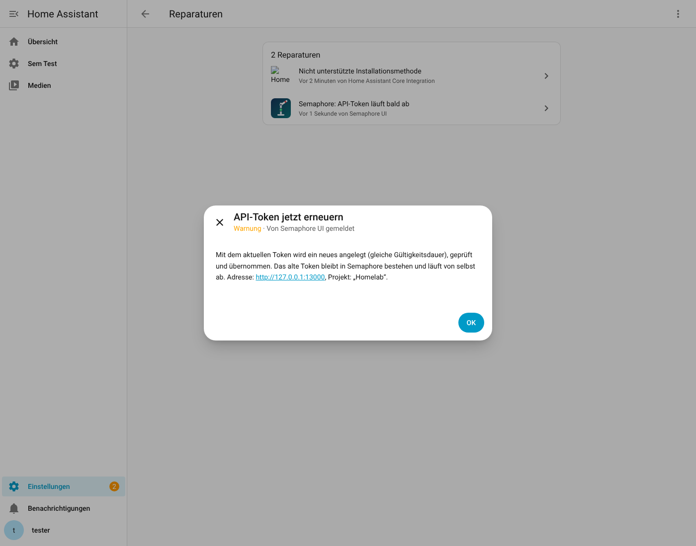

**In der Projekt-Karte:** Nähert sich das Ende (innerhalb der eingestellten Tage, höchstens die halbe Gültigkeit), steht oben ein Hinweis
„Token läuft ab in 20 Stunden · wird automatisch erneuert“ (orange) bzw. „· Erneuerung ist aus“ / „· Erneuerung fehlgeschlagen: …“ (rot);
ein Klick öffnet den Sensor. Ist Semaphore nicht erreichbar, nennt das Banner den **Grund** (Token abgelehnt, Server nicht erreichbar mit
der technischen Meldung, Projekt nicht gefunden) und verlinkt auf die Integration, wo „Neu authentifizieren“ bzw. die Reparatur wartet.
Dafür hat der Sensor „Verbindung“ die Attribute `reason` (`token_rejected`, `unreachable`, `project_missing`), `detail` und `config_entry_id`.

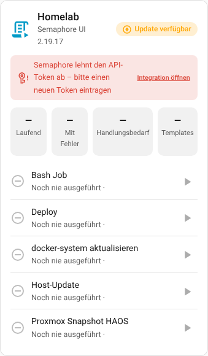

**Notfall-Login (optional):** Ein Token, das Semaphore **schon ablehnt** (abgelaufen oder gelöscht), lässt sich nicht mehr mit sich
selbst ersetzen. Trägst du in den Optionen Benutzer und Passwort ein (oder beim Erneut-Authentifizieren mit dem Haken
„Benutzer und Passwort speichern“), meldet sich die Integration in diesem Fall an, legt ein neues Token an und **meldet sich wieder ab**.
Der Versuch wird höchstens alle 10 Minuten wiederholt, damit ein falsches Passwort kein Konto sperrt. Token und Passwort werden **verschlüsselt** gespeichert
(siehe „Wie sicher liegen Token und Passwort?“ unten; in der Diagnose sind sie geschwärzt). Ein Benutzer mit **zweitem Faktor
(MFA)** geht hier nicht. Ohne gespeicherten Login bleibt alles wie bisher: Das abgelehnte Token startet „Erneut authentifizieren“,
und der Hinweis „API-Token abgelehnt“ erlaubt ein neues Token oder Benutzer und Passwort einzutragen.

### Wie sicher liegen Token und Passwort?

Home Assistant hat keinen Passwort-Safe für Integrationen: Was in einer Integration eingetragen wird, steht normalerweise **im Klartext** in
`.storage/core.config_entries` (auch bei den offiziellen Integrationen). Diese Integration verschlüsselt deshalb Token und das optionale
Notfall-Passwort (Fernet: AES mit Prüfsumme) mit einem zufälligen Schlüssel, der in einer **eigenen Datei** liegt:
`.storage/semaphore_ui.key` (nur für den Home-Assistant-Benutzer lesbar).

- **Geschützt:** Die Konfigurationsdatei allein – etwa in einem Forum gepostet, in einer Teilkopie oder einem Support-Paket – verrät kein Token und kein Passwort.
- **Nicht geschützt:** Wer den **ganzen `.storage`-Ordner** oder ein komplettes Backup samt Schlüssel bekommt, kann alles entschlüsseln – Home Assistant selbst muss den Schlüssel ja lesen können. Dagegen helfen verschlüsselte Backups.
- **Bestehende Einrichtungen** werden beim ersten Start nach dem Update automatisch umgestellt, ohne dass du etwas tun musst.
- **Schlüssel verloren** (z. B. Konfiguration ohne `semaphore_ui.key` wiederhergestellt): Home Assistant fordert ein neues Token an („Erneut authentifizieren“).
- Beim **Ändern der Verbindung** (Neu konfigurieren) wird das gespeicherte Token nicht mehr angezeigt; das Feld leer lassen behält es.

URL, Token oder die SSL-Prüfung später ändern: *Einstellungen → Geräte & Dienste → Semaphore UI → ⋮ → Neu konfigurieren*
(alle Geräte, Entitäten und Verläufe bleiben erhalten).

## Logbuch, Diagnose, Aufräumen

* **Logbuch**: Start und Ende jedes Tasks erscheinen mit dem fertigen Kurztext im Logbuch (z. B. „Semaphore – Host-Update:
  ❌ fehlgeschlagen · 18 s · …“).
* **Diagnose herunterladen** (Eintrag → ⋮ → *Diagnose herunterladen*): Zustand der Templates (und welche abgewählt sind), Version (auch die vom Server
  gemeldete Rohfassung), Intervall und ein Abschnitt `frontend`: wie die Karten registriert wurden (Datei, Pfad, Ressource).
  Token und Adresse sind geschwärzt, Task-Ausgaben und Notizen sind nicht enthalten – sicher für Fehlermeldungen im Repo.
* **Geräte aufräumen**: Das Gerät eines in Semaphore gelöschten Templates kann in Home Assistant über
  *Gerät → ⋮ → Gerät löschen* entfernt werden (Geräte vorhandener Templates und das Projekt-Gerät nicht).

## Bekannte Grenzen (beta)

* Templates vom Typ *build/deploy* (mit Build-Version) lassen sich noch nicht sinnvoll starten.
* Doppelstart-Schutz: Dass „Parallele Tasks“ am Template im Feld `allow_parallel_tasks` der Semaphore-API steht, ist eine
  Annahme aus der API-Beschreibung und noch nicht gegen eine echte Instanz geprüft. Greift das Template-Flag nicht, hilft die
  Option „Mehrfachstart erlauben“ der Integration. Ein in Semaphore gestarteter Lauf sperrt erst nach dem nächsten Abruf.
* Geplantes und Ideen stehen als [Issues](../../issues) im Repository.
* Token-Erneuerung (ablaufendes Token): an einer echten Instanz bestätigt (Semaphore 2.19.17).
* Hinweise (`notes`) und Paketlisten werden gekürzt (10 Hinweise zu je 200 Zeichen, 200 Pakete je Lauf und Host); fehlende Pakete meldet die Karte als „n weitere Pakete nicht aufgelistet“, der Rest bleibt im Log von Semaphore.
* Zeitpläne: Die Integration schaltet sie nur ein/aus und zeigt sie an (anlegen und ändern geht in Semaphore). Der Endpunkt
  `…/schedules/<id>/active` ist im Quellcode von Semaphore 2.19 geprüft, gegen den Nachbau getestet und an einer echten Instanz
  (2.19.17) zum **Ein- und Ausschalten** bestätigt. Fehlt dem Token die Berechtigung, sagt die Meldung es.
  „Nächster Lauf“ ist eine Berechnung aus dem Cron-Text und der Zeitzone; Zeitumstellungen und `@every` sind nur eingeschränkt vorhersagbar.
* Survey: Mehrfachauswahl (*select*) und *secret* nur über die Aktion; Das Senden der Werte folgt dem, was die
  Semaphore-Weboberfläche macht (`environment` bzw. `secret` als JSON-Text im Task) – bitte einmal mit einer
  Variable testen, die in deinem Playbook ausgegeben wird.
* Die automatischen Tests laufen gegen einen Nachbau der API, den ich aus der offiziellen Spezifikation und dem
  Semaphore-Quellcode gebaut habe. Erste Praxistests gegen Semaphore 2.19.17 (Docker) laufen; Rückmeldungen daraus sind in
  0.1.2 eingearbeitet. Neue Funktionen bitte zuerst mit einem harmlosen Template (Testlauf) prüfen.

## Tests

```bash
python3.14 -m venv venv && source venv/bin/activate     # Home Assistant 2026.10 braucht Python 3.14
pip install -r requirements_test.txt
pytest
```

* `tests/fake_semaphore.py` – kleiner Semaphore-Nachbau (aiohttp) mit Projekten, Templates, Tasks, Log-Ausgabe, Token-Prüfung.
  Hier neue Endpunkte/Fälle ergänzen, wenn die echte API anders antwortet.
* `tests/test_report.py` – Log-Auswertung und Bericht (reine Funktionen, schnell).
* `tests/test_survey.py` – Survey-Logik (Defaults, Pflichtfelder, Typen) und Eingabe-Entitäten, Wiederherstellung, Aktion.
* `tests/test_flow_and_entities.py` – Config-Flow, Re-Auth, Optionen, Geräte/Entitäten, Buttons, Aktion mit Warten,
  Ereignisse, entfernte/neue Templates, Server nicht erreichbar.
* `tests/test_extras.py` – Neu konfigurieren, Diagnose (Schwärzung), Logbuch, Geräte löschen, Auslieferung der Karten-Datei
* `tests/test_ha_result.py` – `HA_RESULT` und Fehlergründe aus **echten Ansible-Logs** (`tests/fixtures/`, aufgenommen mit
  ansible-core 2.21 in den Formaten `yaml`/`json`: gefaltete Zeilen, `to_nice_json`, Apostroph/Umlaute, mehrere Hosts, UNREACHABLE, Hinweise `notes`).
* `tests/test_schedule.py` – Cron-Auswertung wie in Semaphore (`robfig/cron`): Felder, Namen, Schrittweiten, Tag/Wochentag-Regel,
  `TZ=`-Präfix, Zeitzonen, ungültige Ausdrücke, einmalige Zeitpläne (reine Funktionen, ohne Home Assistant).
* `tests/test_schedules.py` – Schalter, „Nächster Lauf“, Zeitzone aus Semaphore, Fehler beim Umschalten, Semaphore ohne Zeitpläne,
  gelöschte/neue Zeitpläne, Wiederkehr nach einem Neustart, „Zuletzt erfolgreich“ (Verlauf wird nur einmal je neuem Lauf gelesen).
* `tests/test_filter.py` – Option „Templates in Home Assistant anzeigen“: Geräte/Entitäten/Schalter abgewählter Templates verschwinden
  und kommen zurück, neue Templates erscheinen weiter, mindestens eines bleibt, andere Optionen verlieren die Auswahl nicht,
  ohne Verbindung bleibt sie erhalten, gleiche Namen werden unterscheidbar, Diagnose.
* `tests/test_ha_result.py` enthält auch die Platten-Werte je Host (Rundung, Dezimalkomma, Unsinn wird ignoriert, Prozent über 100).
* `tests/test_repairs.py` – Reparaturen: abgelehntes Token (sofort, Beheben-Dialog mit Prüfung, Token ohne Zugriff, entfernter Eintrag),
  Ausfall erst nach 10 Minuten (auch über Setup-Wiederholungen), kurzer Ausfall ohne Hinweis, Projekt weg (403/404), Hinweise
  verschwinden bei Erholung und beim Entfernen, Texte (Platzhalter in de/en).
* `tests/test_tokens.py` – Token-Pflege: Ablauf lesen (Sensor, kein Ablauf, Liste nicht lesbar), Erneuern vor dem Ablauf (Fenster,
  halbe Laufzeit, neues Token wird geprüft, altes bleibt), Fehlschlag mit Hinweis, Erneuerung aus, Notfall-Login (abgelehntes Token,
  falsches Passwort wird nicht ständig wiederholt, MFA), Formulare (Neu authentifizieren, Reparatur, Optionen), Diagnose ohne Passwort.
* `tests/test_running_overview.py` – Projekt-Sensoren „Laufende Tasks“ / „Template läuft“ nennen die laufenden Templates (auch aus Semaphore gestartete).
* `tests/test_parallel_guard.py` – Doppelstart-Schutz (gesperrter zweiter Start, gleichzeitige Starts, Testlauf, Option
  „Mehrfachstart erlauben“, Template-Flag „Parallele Tasks“, in Semaphore gestartete Läufe, Attribute des Läuft-Sensors).
* `tests/test_action_needed.py` – Handlungsbedarf-Entitäten (entstehen erst bei der ersten Meldung, bleiben nach Neustart, unbekannt
  ohne Meldung, Wiederholung bei nicht lesbarem Log), Projekt-Zähler, Ereignis, Diagnose, Sprache.
* `tests/test_errors_versions_failures.py` – verständliche Fehler im Einrichtungsdialog (DNS, Port, SSL, falsche Adresse, Token),
  Versionsvergleich mit Build-Zusatz, Fehler-Attribute der Problem-Sensoren, Karten-Ressource (echtes Lovelace)
  (und dass die Integration ohne Web-Server/Frontend weiter funktioniert), JavaScript-Syntaxprüfung (`node --check`, wenn Node da ist).

### Browser-Test der Dashboard-Karten (optional, `tests/browser/`)

Startet den Semaphore-Nachbau und ein **frisches Home Assistant** in einem Wegwerf-Ordner und prüft die Karten in einem
echten Chromium (Playwright): Darstellung, Start/Testlauf/Stopp, Rückfrage, Survey-Eingaben samt Fehlermeldung, schmale
Bildschirme/Dunkelmodus, Englisch, Karten-Editor, **zwei Projekte** (Homelab/Testlab mit gleichen Template-Namen),
Karten-Auswahl („Nach Karte“), Dashboard-Ressource, die Fehlertexte im Einrichtungsdialog und die Anzeige „Handlungsbedarf“
(inkl. Ansicht „nur Benötigtes“), außerdem Zahlen je Host und Hinweise, anklickbare Zeilen, die **Kachel-Filter** und die
**Versionsanzeigen** der Projekt-Karte, die **Zeitpläne** (Schalter wirkt auf Semaphore, „Nächster Lauf“, „Zuletzt erfolgreich“), den **Kringel** nach dem Klick
(Schalter, Starten) und
die **Token-Pflege** (Sensor, Optionen, Reparatur „Beheben“ legt ein neues Token an) und
die **Bilder für diese Doku**. Dauert gut zwei Minuten.

```bash
pip install playwright && playwright install chromium        # einmalig
HA_PYTHON=venv/bin/python PW_PYTHON=venv/bin/python bash tests/browser/run_e2e.sh
```

**Bilder der Doku** (`docs/screenshots/`): Der Lauf erzeugt sie immer im Arbeitsordner (`shots/docs/`); mit
`UPDATE_SCREENSHOTS=1 bash tests/browser/run_e2e.sh` landen sie in `docs/screenshots/` – das macht man vor einem Release und
committet sie mit. Sonst bleiben die Bilder im Repo unverändert (sie enthalten Uhrzeiten und würden bei jedem Lauf abweichen).

`KEEP=1` behält den Arbeitsordner (Screenshots in `shots/`, Logs `ha.log`, `fake.log`); bei Fehlern bleibt er automatisch erhalten.
Läuft nicht unter `pytest` (kein `test_*.py`) und ist für die normale Testausführung nicht nötig.

Fehlerbild aus der Praxis (anderes Ansible-Log, anderer Status)? Log-Auszug in `tests/test_report.py` als neuen Fall ergänzen
und `custom_components/semaphore_ui/report.py` anpassen.

## Aufbau

```
custom_components/semaphore_ui/
  api.py           REST-Client (Bearer-Token)
  report.py        Bericht + Log-Auswertung inkl. HA_RESULT (ohne Home-Assistant-Abhängigkeit)
  schedule.py      Cron-Auswertung wie in Semaphore, „nächster Lauf“ (ohne Home-Assistant-Abhängigkeit)
  coordinator.py   Abfrage, Start/Ende-Erkennung, Ereignisse, Start/Stopp/Warten; Versions-Coordinator
  config_flow.py   Einrichtung, Re-Auth, Neu konfigurieren, Optionen (inkl. Template-Auswahl)
  issues.py        Reparatur-Hinweise (Token, nicht erreichbar, Projekt weg) erzeugen und aufräumen
  tokens.py        Token-Pflege: Ablauf lesen, rechtzeitig erneuern, Notfall-Login (Sensor, Reparatur „läuft bald ab“)
  repairs.py       Beheben-Dialoge: Token abgelehnt (Token oder Login eintragen), Token jetzt erneuern
  survey.py        Survey-Variablen: Defaults, Pflichtfelder, Typen (ohne Home-Assistant-Abhängigkeit)
  survey_entity.py · text.py · number.py · select.py   Eingabe-Entitäten der Survey-Variablen
  sensor.py · binary_sensor.py · button.py · event.py · update.py · switch.py (Zeitpläne)
  cards.py         liefert frontend/ aus, lässt Home Assistant die Karten-Datei laden und trägt sie als Dashboard-Ressource ein
  brand/           Logo von Semaphore UI (mit Erlaubnis), icon.svg + icon.png + icon@2x.png
  frontend/semaphore-ui-card.js   Template-Karte, Projekt-Karte, Karten-Editor (reines JavaScript, kein Build-Schritt)
  diagnostics.py · logbook.py
  services.yaml · icons.json · translations/{de,en}.json
tests/browser/     optionaler Browser-Test der Karten (siehe oben)
docs/screenshots/  Bilder der Karten für dieses README (vom Browser-Test erzeugt)
playbooks/        Beispiel-Playbook für HA_RESULT
```

Karten ändern: nur `frontend/semaphore-ui-card.js` bearbeiten – die Datei wird beim Start mit ihrem Änderungsdatum als
Version ausgeliefert, nach einem Neustart und Neuladen des Browsers ist die neue Fassung aktiv.
