# Semaphore UI for Home Assistant (beta)

🇩🇪 [Deutsche Version](README.md)

[](https://my.home-assistant.io/redirect/marketplace_repository/?owner=19Andy89&repository=hacs_semaphoreui&category=integration)

Controls [Semaphore UI](https://semaphoreui.com) (Ansible/Terraform/Bash templates) from Home Assistant.
One entry per Semaphore **project**, one device per **template** – with status, start/dry run/stop
and a ready-made **report**: what was started when, how long it ran, the result and – for failures – why.
Two **dashboard cards** (template and project) are included and loaded by the integration itself.

Tested with Home Assistant 2026.10 (browser test) and the current version (CI, see `tests/`); minimum version 2026.10.0, older versions are not tested. Runs entirely locally, no cloud.

> **Unofficial:** This project is an independent community project and has **no affiliation** with Semaphore UI
> or its developers; it is neither supported nor endorsed by them. It uses only the public
> REST API of a Semaphore instance. If that API changes, the integration here has to be adapted – please report bugs
> in **this** repository, not to the Semaphore project.
> “Semaphore” and “Semaphore UI” are names of the respective project and are used here only to name what the integration talks to.
> The icon is the **Semaphore UI logo** (see [Icon](#symbol-icon)); the Semaphore UI project has allowed its use for this
> unofficial community integration. That does not make this an official product.
> The actual project: [semaphoreui/semaphore](https://github.com/semaphoreui/semaphore) ·
> [Website](https://semaphoreui.com) · [Documentation and API](https://docs.semaphoreui.com).

## What it looks like

The images are produced in the browser test from sample data (see [Tests](#tests)); names and hosts are made up.

The screenshots show the German interface; the cards and entities follow your Home Assistant language (German/English).

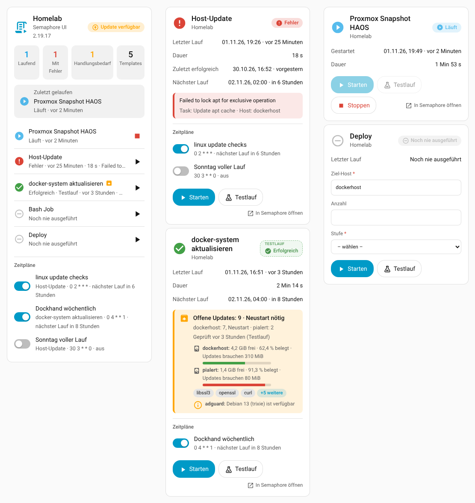

| Project card | Template card: updates pending | Template card: error |
|---|---|---|
| 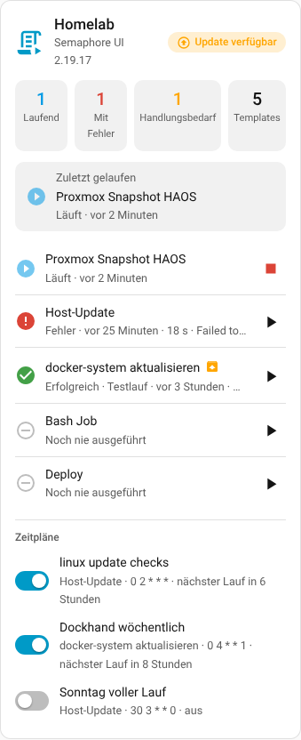 | 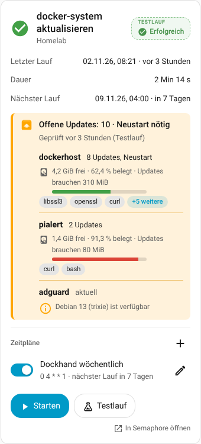 | 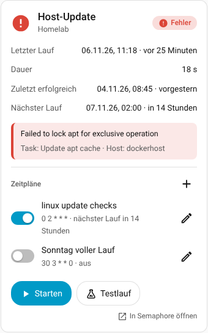 |

<details>
<summary>Dark theme, smartphone, more cards</summary>

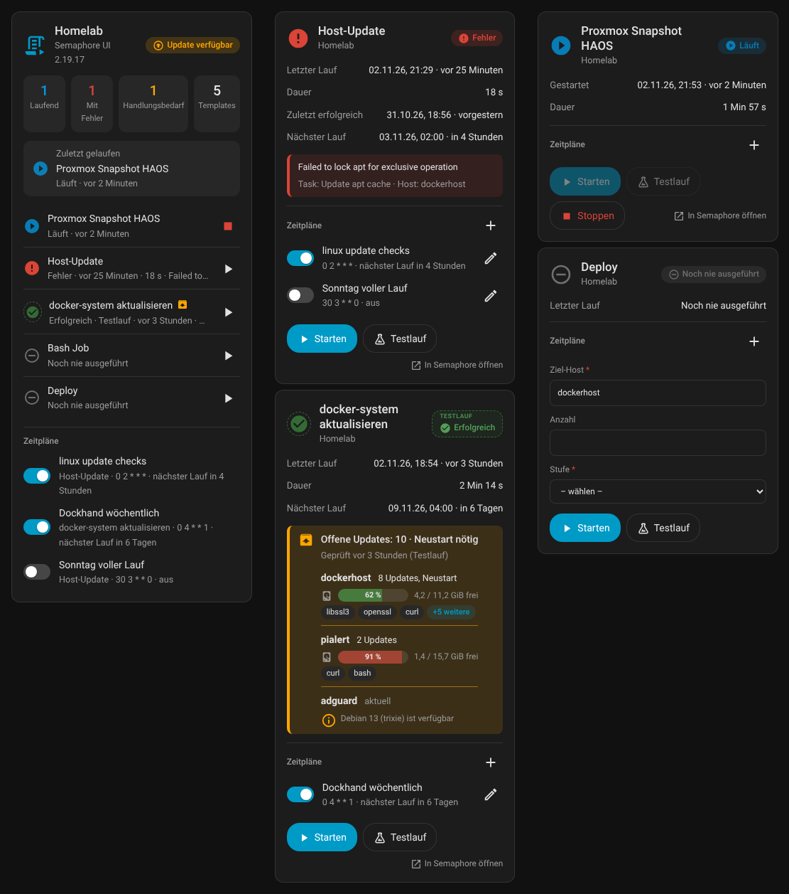

| Project card, smartphone, dark | Template card, smartphone, dark |
|---|---|
| 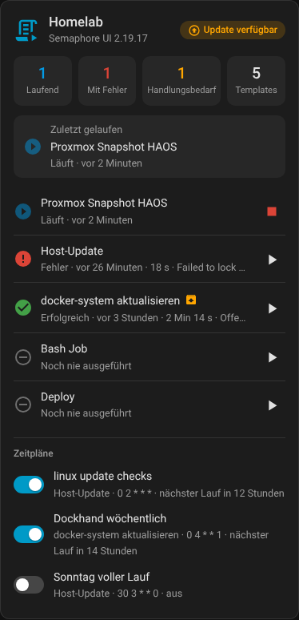 | 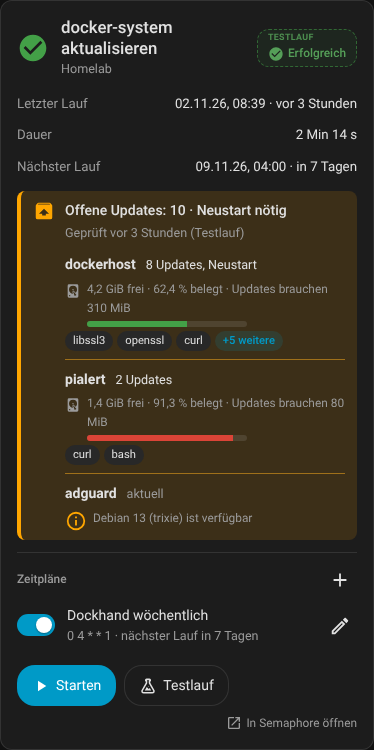 |

| Running | With survey inputs | Versions (Semaphore and integration) | Only what is needed (`only_needed`) | Packages expanded (“+5 more” clicked) |
|---|---|---|---|---|
| 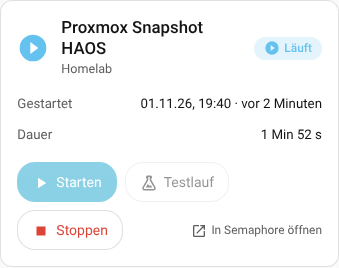 | 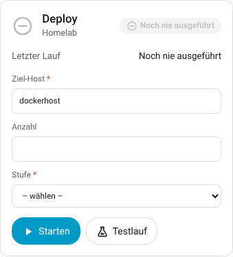 | 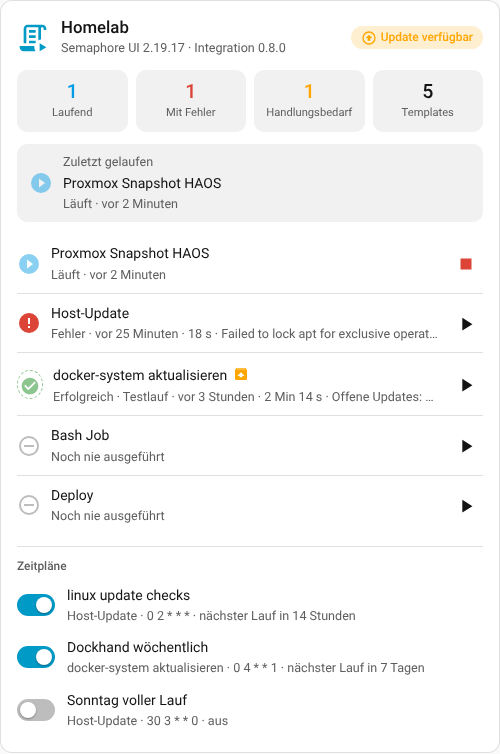 | 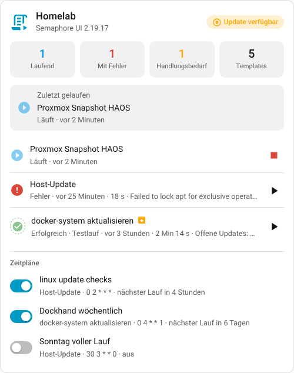 | 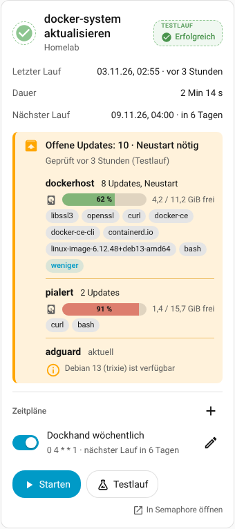 |

| Project card: entry unfolded (click on the name) |
|---|
| 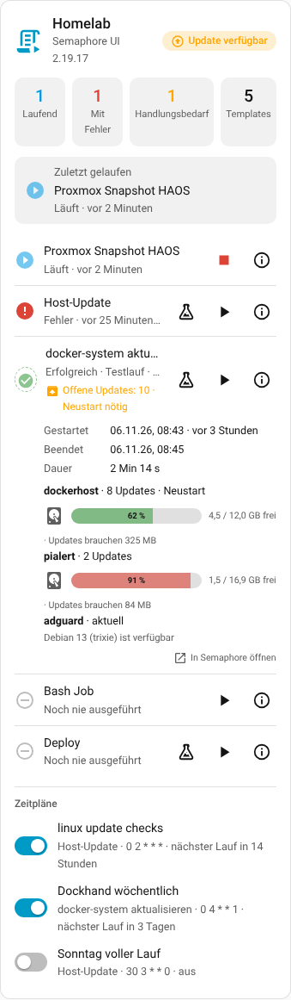 |

</details>

## Installation

**Via the Marketplace / HACS (recommended):** click the badge above (“Open your Home Assistant instance …”) or add the repository `19Andy89/hacs_semaphoreui` as a custom repository (category *Integration*), install it and restart Home Assistant. Updates then show up like those of any other integration; pre-releases (`-dev.N`) appear only with “Show beta versions”.

**Manually:**

1. Copy the folder `custom_components/semaphore_ui` to `/config/custom_components/semaphore_ui`.
2. Restart Home Assistant.

Then (both ways):

3. Create an API token in Semaphore: user name (top right) → **API tokens** → **New token**.
4. *Settings → Devices & services → Add integration → “Semaphore UI”*:
   URL (e.g. `https://semaphore.example.de`) + token → then pick the **project** from the list.
   The token may have an expiry date: the integration displays it and renews the token in time
   (see [Token maintenance](#token-maintenance-expiry-renewal)).

Multiple projects: simply add the integration multiple times.
Please enter the URL the way it is reachable without a redirect (`https://…`), otherwise POST requests get lost.

## Devices and entities

### Project device “Semaphore – <project name>”

| Entity | Content |
|---|---|
| Available (`binary_sensor`; German UI: „Verfügbar“) | API reachable? Stays available and shows “off” even when Semaphore is offline |
| Semaphore update (`update`; German UI: „Semaphore-Update“) | installed version vs. latest version (display only, installs nothing). A build suffix such as `2.19.17-f8cefe6-1792391878` is ignored; the raw version is in the attribute `installed_version_reported` |
| Template count (German UI: „Anzahl Templates“) | Number; attribute `templates` = all names |
| Running tasks (German UI: „Laufende Tasks“) | waiting/running tasks in the project. Attributes: `templates` (names of the templates currently running), `task_ids`, `details` (per template: `template`, `template_id`, `task_ids`, `status`, `dry_run`, `started`) – also for runs that were started in Semaphore itself (schedule, web interface) |
| Template running (`binary_sensor`; German UI: „Template läuft“) | on as long as at least one task of the project is waiting or running; same attributes as “Running tasks” – handy as a visibility condition or automation trigger (“something is running right now”) |
| Last template run (German UI: „Zuletzt gelaufenes Template“) | Name; attributes = complete report of that task |
| Last run status (German UI: „Status des letzten Laufs“) | `success`, `error`, `running`, … (enum) |
| Last run started (German UI: „Letzter Lauf gestartet“) | Timestamp |
| Templates with error (sensor + problem sensor; German UI: „Templates mit Fehler“) | Count or on/off respectively. Attributes: `templates` (names), `explanation` (one line per template: template, task no., time, reason, failed step, host), `failed_runs` (the same information, structured, with a link to the task in Semaphore) |
| Templates needing action (sensor; German UI: „Templates mit Handlungsbedarf“) | Number of templates whose last run reported via `HA_RESULT` that something needs doing (see [Action needed](#action-needed-what-needs-doing-right-now-ha_result)). Attributes: `templates`, `explanation` (one line per template), `details` |
| Next scheduled run (`sensor`, timestamp; German UI: „Nächster geplanter Lauf“) | when the earliest **active schedule** of the project starts next time (see [Semaphore schedules](#semaphore-schedules)); unknown if no schedule is active. Attributes: `schedule`, `template`, `timezone`, `schedules` (all schedules with `name`, `template`, `cron`, `active`, `next_run`, `entity_id` of the switch) |
| Tasks (`event`) | fires `started` / `success` / `failed` / `stopped`, attributes = report |

### Template device (one per template)

Status · Last started · Last ended · Last duration · Summary (text, attributes = report) ·
Running · Last run failed (attributes `reason`, `failed_task`, `host`, `task_id`, `url`, `explanation`, for as long as
the error persists) · buttons **Start**, **Dry run** (Ansible templates only), **Stop**.
In addition – only for templates whose playbook outputs `HA_RESULT` – **Needs action** (on/off) and **Pending updates** (number).
Every template also gets **Last success** (timestamp of the end of the last run with status *success*; attributes
`task_id`, `started`, `duration`, `dry_run` – a successful dry run counts, `dry_run` tells you). If the last run did not end
successfully, the integration reads the history of this template once to find the last success (also after a restart
of Home Assistant). And – only for templates with a schedule in Semaphore – **Next run** (timestamp, attributes `schedule`,
`timezone`, `schedules`) and, for each schedule, a **switch** (see [Semaphore schedules](#semaphore-schedules)).

**No double start:** As long as a run of the template is **waiting or running**, **Start** and **Dry run** are blocked (card,
button and action; **Stop** keeps working). The action then reports “Template … is already running or queued (task …)”. This also applies
to runs that were started in Semaphore itself (schedule, web interface) – as soon as they show up at the next poll
(polling interval, default 30 s). The **Running** sensor provides the attributes `task_ids` (all open tasks) and `parallel_allowed`
(`true` if another start would be allowed). To lift the block: the option **Allow starting again** (German UI: „Mehrfachstart erlauben“) or “Allow parallel tasks” on the template in Semaphore (then it applies only to that template).
In automations that press a dry run on a schedule, run the action with `continue_on_error: true` or check beforehand
that the **Running** sensor is off.

**When does it say “Problem”?** The project’s problem sensor is on as long as the **last run of at least one template**
failed – not just the most recently run task of the project. “Last run status” can therefore
show “success” (another template ran successfully afterwards) while the problem sensor stays on. Which template and why
is in the attribute `explanation`. The sensor goes off as soon as that template has run successfully again.

New templates appear automatically, deleted devices disappear automatically.

### Survey variables (prompts at start)

If a template has survey variables, the template device gets one **input entity** per variable in the
category *Configuration*; name = title of the variable, default value = default from Semaphore.
The **Start** / **Dry run** buttons send exactly these values.

| Type in Semaphore | Entity |
|---|---|
| String, Text | `text` |
| Integer | `number` (whole numbers) |
| Enum | `select` (label is shown, the value is sent) |
| Select (multiple choice), Secret | **no entity** (secrets should not end up in the state store/database) – the **card** asks for them in a dialog at start, otherwise the action does |

The values are kept across a restart. Semaphore’s API does not check required fields and defaults itself
(the web interface normally does that) – so the integration does it: missing values are filled with the default,
a required field without a value, an unknown name or an invalid value aborts **before** the start with a clear
message (e.g. `missing: stage, token (secret: only via the action)`).
Changed variables in Semaphore (new, removed, new enum values) are picked up automatically.

**Dialog in the template card:** If a template has secrets or multiple-choice variables, *Start* or *Dry run* in the card
opens a small dialog instead of starting immediately (password field per secret, checkbox per choice, defaults ticked, required fields
marked with `*`). Only *Start* in the dialog starts the run (the dialog replaces the confirmation prompt of `confirm_start`). The values of the card’s
normal input fields are sent along. The secret is sent **only** as an action call `semaphore_ui.run_template` (`survey`) to Home Assistant
and from there as a secret to Semaphore – it appears in no state and no entity and disappears with the dialog.
(Like every action call, it briefly passes over Home Assistant’s event bus; automations listening for `call_service`
would see it.) Which variables the dialog asks for is in the attribute `survey_dialog` of the start button (without the defaults of secrets).

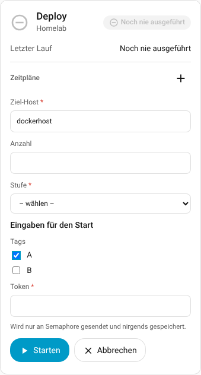

## Action needed: “What needs doing right now?” (`HA_RESULT`)

For cards to appear only when they are needed (e.g. “there are updates”), the integration has to know **what
a dry run found**. Ansible alone does not reveal this: the numbers in the `PLAY RECAP` (`changed=…`)
say nothing about whether packages are pending for host updates. That is why the playbook outputs **one line** at the end:

```
HA_RESULT {"updates": 3, "reboot_required": false}
```

### In three steps

1. **Put the building block at the end of the playbook** (Ansible building block further below, ready to copy for Debian/Ubuntu hosts). It
   simulates the updates and outputs the `HA_RESULT` line. For playbooks that really upgrade as well, it belongs **after**
   the upgrade: then a real run shows “0”, a dry run shows the pending updates.
2. **Start the template once as a dry run** (*Dry run* button in the card). After that the entities *Needs action*
   and *Pending updates* exist for this template. Check regularly: see “Schedules in Semaphore (notes)” further below.
3. **Display**: The template card shows the box “Pending updates …”, the project card the tile “Needs action” (click =
   only these templates). For “show the card only when something needs doing”, set a visibility condition on the sensor.

### What the integration does with it

The integration looks for this line in the log of a template’s **most recently finished run** (dry run or real run – no matter who
started it, including a schedule in Semaphore) and creates the following per template:

| Entity | Content |
|---|---|
| **Needs action** (`binary_sensor`; German UI: „Handlungsbedarf“) | on = updates pending or reboot required; off = nothing to do; *unknown* = the last run reported nothing (e.g. it failed). Attributes: `updates`, `reboot_required`, `explanation`, `hosts` (per host: `updates`, `reboot_required`, `needed`, `notes`, `disk_free_mib`, `disk_required_mib`, `disk_used_percent`), `packages`, `notes`, `checked`, `checked_local`, `dry_run`, `task_id`, `url` |
| **Pending updates** (`sensor`; German UI: „Offene Updates“) | Number of pending updates (all hosts combined) |
| **Templates needing action** (project sensor) | Count; attribute `templates` = names |

The two template entities exist only for templates that have reported `HA_RESULT` at least once (they stay afterwards). The
report (event, action response, summary) also contains `ha_result`; the push text gets
a line “Pending updates: 3 · Reboot required”.

**Keys of the JSON object** (all optional): `updates` (number), `reboot_required` (true/false), `packages` (list of names,
display only, max. 50; the card shows them in one line with “+n more”), `host` (otherwise the host from the Ansible output), `needed` (true/false – overrides the rule),
`notes` (text or list of texts, see below; `note` is read as well).
**Host disk** (optional, display only): `disk_free_mib` (free space on `/` in MiB), `disk_required_mib` (space the updates need, in MiB)
and `disk_used_percent` (used, 0–100). The cards convert to MB/GB (1 MiB = 1.048576 MB) and show them per host as “4.5 / 12.0 GB free · 62.4 % used · updates need 325 MB” (the need only while updates are open)
with a bar (orange from 80 %, red from 90 %); hosts without these values get no line. They do not change the action-needed state.
Invalid values (negative, not a number, percent above 100) are ignored individually. The bundled `playbooks/update-linux.yml` reports them.
Unknown keys are ignored. Without `needed` the rule is: **action needed if `updates` > 0 or `reboot_required` is true.** With multiple hosts the
last line per host counts; the numbers are added up, one host in need is enough.

**When does the state change?** What counts is always the **last finished** run. While a new run is waiting or
running, the previous result stays. If the run ends without `HA_RESULT` (or fails without reporting), the
state is *unknown*. That is why you should put the building block **at the end** of the playbook: in a dry run it shows the pending updates, after
a real run the same check shows “0”. If the log cannot be read (Semaphore does not answer), the integration retries
up to 5 times on the next polls.

**Ansible building block for Debian/Ubuntu hosts** (Pi-hole, LXC, Proxmox host …); tested with ansible-core 2.21, in the
output formats `yaml` and `json`, with and without `--check`:

```yaml
    - name: Paketlisten aktualisieren (auch im Testlauf, damit die Simulation aktuell ist)
      ansible.builtin.apt:
        update_cache: true
        cache_valid_time: 3600
      check_mode: false
      become: true

    - name: Simulation - was würde installiert?
      ansible.builtin.command: apt-get -s dist-upgrade
      register: apt_sim
      changed_when: false
      check_mode: false          # the simulation changes nothing, so it may run in a dry run

    - name: Neustart nötig?
      ansible.builtin.stat:
        path: /var/run/reboot-required
      register: reboot_flag

    - name: Ergebnis für Home Assistant melden
      ansible.builtin.debug:
        msg: >-
          HA_RESULT {{ {'updates': (apt_sim.stdout_lines | select('match', '^Inst ') | list | length),
                        'reboot_required': reboot_flag.stat.exists,
                        'packages': (apt_sim.stdout_lines | select('match', '^Inst ') | map('regex_replace', '^Inst (\S+).*$', '\1') | list)} | to_json }}
```

The template must support “dry run” (`--check`); the result appears as soon as the run has finished. If you never want a template
to stand out because of a pending reboot, simply leave out `reboot_required`.

**Notes (`notes`):** With `"notes": "text"` or a list, the playbook passes along notes that are **displayed but not counted as
action needed** – e.g. that a new Debian version exists. The template card shows up to 3 notes (with
multiple hosts including the host name, the rest as “+ n more”), they are in the attribute `notes` of the *Needs action* sensor
and – up to 3 – as lines “Note (host): …” in the push text. Per run at most 10 notes of 200 characters each
are taken over; duplicates are dropped.

**Important – order:** `HA_RESULT` can only contain what was computed **beforehand**. The line therefore belongs after all
checks that provide notes (also after a Debian check). Example: the note “new Debian version” comes from a
comparison of the installed with the current stable version (`debian_stable_major` / `debian_stable_codename`, from a
query of `deb.debian.org/debian/dists/stable/Release`) and then goes into `notes`:

```yaml
    - name: Hinweis für Home Assistant vorbereiten      # only AFTER the Debian check
      ansible.builtin.set_fact:
        debian_hinweis: >-
          Debian {{ ansible_facts.distribution_major_version }}
          ({{ ansible_facts.distribution_release }}) installiert,
          aktuell stabil ist Debian {{ debian_stable_major }}
          ({{ debian_stable_codename }})
      when:
        - ansible_facts.distribution == "Debian"
        - debian_stable_major is defined
        - (ansible_facts.distribution_major_version | int) < (debian_stable_major | int)

    - name: Ergebnis für Home Assistant melden          # at the very end
      ansible.builtin.debug:
        msg: >-
          HA_RESULT {{ {
            'updates': (upgrade_final.stdout_lines | select('match', '^Inst ') | list | length),
            'reboot_required': reboot_required.stat.exists,
            'packages': (upgrade_final.stdout_lines | select('match', '^Inst ') | map('regex_replace', '^Inst (\S+).*$', '\1') | list),
            'notes': ([debian_hinweis] if debian_hinweis is defined else [])
          } | to_json }}
```

> **The playbooks in the [`playbooks/`](playbooks/) folder are examples.** They contain no hosts, credentials or addresses and show how a playbook reports `HA_RESULT`. Adjust `hosts:` (a group in your inventory) and the thresholds, and try them as a **dry run** (`--check`) first. For other jobs (Docker, deploy, …) you need your own playbook with a `HA_RESULT` line; the integration also works without one (then you get status and report, but no “action needed”).

A complete, tested playbook (disk space check, update, reboot check, Debian check, `HA_RESULT` with
note) is available at [`playbooks/update-linux.yml`](playbooks/update-linux.yml); for **Proxmox hosts** (dist-upgrade, restart needed also when a newer kernel is installed) there is [`playbooks/update-proxmox.yml`](playbooks/update-proxmox.yml); the output in `yaml` and `json` format is
stored as a test case.

**Report on failures, too:** If a pre-check aborts (not enough space, apt error), no action-needed sensor would ever be created
for the host without a report. The bundled playbook therefore wraps the pre-checks in a `block`; in the `rescue` it outputs
`HA_RESULT {"needed": true, "notes": ["Update nicht gestartet: …"], "disk_free_mib": …}` and then lets the run fail with `fail`.

**Dashboard:** In the card, under **Visibility**, set a condition “Entity → State” on the *Needs action* sensor
(state `On`) – the card appears only when something needs doing. The project card can show everything in one list:
the option `only_needed: true` hides templates without action needed, without errors and without a running task.
In the project card, a click on a template unfolds its details (times, failure reason, result per host, link to Semaphore); the info icon on the right of the row opens More-info.
**Keep the template card visible for 24 hours after a run:** switch on “Keep templates visible for 24 hours after a run” in the integration **options**.
Every template then has the diagnostic sensor **Card visible** (`binary_sensor`, attributes `reason` = `running` / `error` / `needs_action` / `recent`, `until`):
on while it runs, failed, reports action needed or – only with the option – ran less than 24 hours ago and was not “marked as done”.
Use it as the visibility condition of the card (“Entity → State → On”), or tick **“Hide the card when there is nothing to show”** in the template card
(`hide_when_idle: true`; the card stays visible in edit mode). The button **Mark as done and hide** in the card (or the button entity *Mark as done*) ends the visibility earlier; a new run shows the card again.
With `show_recent: true` in addition, a template stays visible for **24 hours after its run**, even if nothing else needs doing; a button (eye) “Mark as done and hide” hides it earlier (button entity *Mark as done*, valid for all devices; a new run shows it again).
For updates that Home Assistant knows itself (Core, OS, Supervisor, containers), the same visibility condition on
the respective `update` entity is enough – no `HA_RESULT` is needed for that.

**Check regularly:** The sensor is only as current as the last run. The easiest way to start a nightly dry run is
an automation in the UI (trigger *Time*, action *Press button* on the template’s *Dry run* button)
or a schedule in Semaphore (see below).

### Schedules in Semaphore (notes)

* **Cron expression:** `0 2 * * *` starts **once at 02:00**. `* 2 * * *`, on the other hand, runs **every minute** between 02:00 and 02:59.
* **Time zone:** By default Semaphore evaluates schedules in **UTC** – “02:00” is therefore 03:00 or 04:00 in Germany.
  You can change this when starting Semaphore with the environment variable `SEMAPHORE_SCHEDULE_TIMEZONE` (e.g. `Europe/Berlin`).
  The integration reads the time zone from Semaphore (`/api/info`) and uses it to compute “Next run”.
* **Dry run via schedule:** Schedules in Semaphore (tested with 2.19.17) have no dry-run option. Create a
  **second template** with the playbook and the *Extra CLI Arguments* `["--check"]` for this (e.g. “linux lxc check”) and schedule that one;
  the template without `--check` remains for the actual updating.
* **Runs from schedules are detected:** What counts is the last finished run, no matter who started it. After the
  next poll it shows up in the entities, in “Template running” and in the card; while it runs, *Start* and
  *Dry run* are blocked (double-start protection).
* Showing schedules in Home Assistant and switching them on/off: see the next section.

## Semaphore schedules

Schedules run **in Semaphore** (cron or one-time); Home Assistant displays them and switches them on/off – this way
Semaphore itself decides when something starts, and a restart of Home Assistant changes nothing about that.

* **Switch per schedule** (`switch`, on the template’s device, name “Schedule <name>”): on = active. Toggling sends only the
  flag `active` to Semaphore (`PUT /api/project/<id>/schedules/<id>/active` with `{"active": true|false}`); cron text,
  template and everything else stay unchanged. The display flips immediately, the next poll confirms it. In the card a spinner turns on the switch meanwhile,
  a second click is ignored. If you switch directly in Semaphore instead, it reaches Home Assistant with the next poll
  (default: every 30 seconds, adjustable under *Options*). If the
  call fails (e.g. missing permission of the token), the reason is in the Home Assistant message and the switch stays
  as it was. Switches appear and disappear with the schedules in Semaphore.
* **Next run** per template and **Next scheduled run** in the project (timestamp). The integration evaluates the cron text
  the way Semaphore does (library `robfig/cron`, five fields, `@daily` & co., month and weekday names, time zone of
  Semaphore or a `TZ=Europe/Berlin ` prefix in the expression). One-time schedules (`run_at`) show their point in time. Switched-off
  schedules and `@every …` (the interval starts when it is loaded in Semaphore and cannot be predicted) have no “next run”.
* **Cards:** the template card shows “Next run”, “Last success” and the switches of its template; the project card
  lists all schedules of the project (earliest first, switched-off ones last). The option `show_schedules: false` hides the
  section.
* **Automations:** The switch is a normal `switch` – e.g. “Schedule Linux updates only on when someone is home”.
* **Create, change, delete:** In the **template card** there is a “+” next to the “Schedules” heading and a pencil per schedule. A small form opens (cron text, name; deleting asks once more). Below the cron text, as you type, it shows what it means (“Daily at 02:00”, “Every 2 hours from 00:00”, “Mondays to Fridays at 06:00”). For unusual expressions the line stays empty. When creating, you can switch to **One-time**: date and time (browser time) instead of cron text, plus “Delete after run”. `edit_schedules: false` hides both. The project card remains display-only. The card uses these actions, and you can call them yourself as well:

  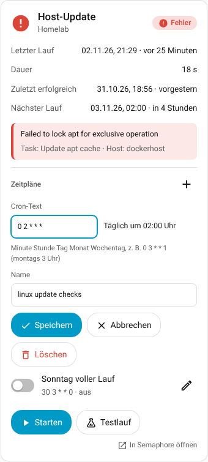

  * `semaphore_ui.create_schedule` – target: the **template device**; either `cron` (five fields as above) **or** `run_at` (one-time, date and time in the time zone of Home Assistant, sent to Semaphore as UTC), plus `name` (default: name of the template), `active` (default: on), `delete_after_run` (default: off). Response: `schedule_id` and `name`.
  * `semaphore_ui.update_schedule` – target: the schedule’s **switch**; fields `cron`, `run_at`, `name`, `template_id`, `active`, `delete_after_run`. Fields not given stay unchanged; `cron` makes the schedule recurring, `run_at` one-time.
  * `semaphore_ui.delete_schedule` – target: the schedule’s **switch**. The switch disappears with the next poll.

  The cron text is checked beforehand with the same logic as for “Next run”; an error is then clearly stated in the message, and Semaphore is not asked.
  When changing, the integration sends the **whole** schedule (`PUT /api/project/<id>/schedules/<id>`), because Semaphore expects it that way.
  Example: `action: semaphore_ui.create_schedule` with `target: {device_id: …}` and `data: {cron: "0 3 * * 1", name: "Montags"}`.
  How exactly Semaphore expects one-time schedules (`type: run_at`, timestamp in `run_at`) is derived from the source code and has not yet been verified against a real instance.

## Dashboard cards

The integration ships a JavaScript file with two cards and loads it itself. There are two ways to do this, and they are
used at the same time: it is loaded together with the UI **and** registered as a dashboard resource
(*Settings → Dashboards → ⋮ → Resources*, entry `/semaphore_ui_static/semaphore-ui-card.js`, type “JavaScript module”;
updated with every update). You do not have to enter anything. If `resources:` is in your `configuration.yaml`
(YAML mode), that list is left untouched; in that case add this as well:
`- url: /semaphore_ui_static/semaphore-ui-card.js` / `type: module`.

After the initial setup or after an update of the integration, restart Home Assistant once and reload the browser
(Ctrl+Shift+R; in the app: clear the cache).

### How to find the cards

1. Open the dashboard → ✏️ **Edit** → in a section **＋ Add card**.
2. The dialog opens on the tab **“By entity”** (German UI: „Nach Entität“) – only entities appear there. Switch to the tab **“By card”** (German UI: „Nach Karte“)
   and search for **“Semaphore”**: “Semaphore UI – Template” and “Semaphore UI – Projekt” (project).
3. After the click, the first matching device is already preselected, and you see the preview on the right.

### Which device?

* **Template card** → a **template device**. The selection list shows only these, as **“Project › Template”**
  (e.g. “Homelab › Host-Update”), so that identical names in two projects can be told apart. With more
  than one project, the card shows the project name under the title.
* **Project card** → the **project device** “Semaphore – <project name>” (shows all templates of this project).
* Each card has its **own** device. With two projects (Homelab, Testlab) you therefore pick the matching project
  or template for each card; there is no global setting.
* In YAML: `device_id` is the device ID (editor → “Show code editor”). A wrong device makes the card show the note
  “This is not a suitable Semaphore device” (German UI: „Das ist kein passendes Semaphore-Gerät“).

### Template card `custom:semaphore-ui-template-card`

One template: status chip (color/icon, pulses while the run is active), last run (date and “5 minutes ago”),
duration (counts live while the task runs), for errors the **failure reason** with task and host, the parameters
used at start, the **input fields of the survey variables** (required fields with `*`) and the buttons **Start**, **Dry run**
(Ansible only) and **Stop** (only while something is running). Tap the title = more-info, “Open in Semaphore” jumps to the task.
If Semaphore reports an error at start (e.g. a required survey value is missing), it is shown directly in the card.
If the last run was a **dry run**, the status badge at the top right shows two parts, “Dry run / Success” (or “Error”), in a lighter color with a dashed border; the project card mentions it in the subtitle.
If the playbook outputs `HA_RESULT`, the card shows a box “Pending updates: 5 · Reboot required” (with check time, dry-run note
and the package names) or “nothing to do”. The **package names are on one line**; whatever does not fit is summarized as “+5 more”.
A **click on “+5 more”** shows all packages (they may then wrap), a click on “less” collapses them again –
also by keyboard (Enter/Space). How many names are visible depends on the width of the card (also on the phone). With **multiple hosts**, below it is shown who has how many
(“adguard: 5 · pialert: 6, reboot”); **notes** from the playbook (`notes`) follow below. The rows **Last run** and
**Duration** as well as the **error text** are clickable: a click opens Home Assistant’s standard view (more-info with
history) of the respective sensor – also by keyboard (Enter/Space). If the template has schedules, the card shows “Next run”,
and, if the last run was not successful, also “Last success”, and below that the **schedules with switch** (name, cron text,
next run; a click on the name opens the standard view of the switch).
After a click on **Start**, **Dry run**, **Stop** or a schedule switch, a **spinner** turns until Semaphore has
answered – this makes clear that the click arrived; a second click during that time is ignored (project card: likewise
for start and stop in the list).

```yaml
type: custom:semaphore-ui-template-card
device_id: 0123456789abcdef0123456789abcdef   # template device (pick in the editor)
name: Docker-Stacks aktualisieren              # optional
show_survey: true                              # input fields of the survey variables (default: true)
show_details: true                             # failure reason + parameters (default: true)
confirm_start: true                            # "Really start?" before starting (default: false)
show_schedules: true                           # schedules with switch (default: true)
edit_schedules: true                           # "+" and pencil: create, change, delete schedules in the card (default: true)
```

### Project card `custom:semaphore-ui-project-card`

The whole project at a glance: name, Semaphore version (can be turned off) and an “Update available” note, warning bar when
Semaphore is not reachable, counters (running / with error / needs action / templates), the **most recently run task** with
status, time and duration, and the list of **all templates** (running, failed and those needing action first) with
a short info per row and a **start/stop button**. The “Needs action” tile appears as soon as a template reports `HA_RESULT`.

* **The tiles are filters:** A click on *Running*, *With error* or *Needs action* shows only the affected templates
  (highlighted); tap again or tap the *Templates* tile to show all again. If there is no match, a short
  note appears (“Nothing is running right now.”). The filter applies only to the tapped card and only while the page is open.
* **Versions:** `show_version` shows/hides the Semaphore version (default: on), `show_integration_version` shows the version
  of the integration after it (“Semaphore UI 2.19.17 · Integration 0.1.5”, default: off). If you pick the integration’s `update` entity from HACS
  for `hacs_update_entity`, its installed version is added to the line, plus a note
  “Integration update” as soon as HACS reports an update (a click opens the update entity). Without a selection the note is omitted.
* With `templates` (see below) the list can be limited to individual template devices – the tiles continue to count the whole project.
* **Schedules:** Below the list are all schedules of the project with switch, template, cron text and next run
  (`show_schedules: false` hides them; Semaphore’s time zone is shown as a note at the heading).

```yaml
type: custom:semaphore-ui-project-card
device_id: 0123456789abcdef0123456789abcdef   # project device
name: Homelab                                  # optional
sort: status                                   # status | name | last_run
show_never_run: true                           # show templates without a run
only_needed: false                             # true = only templates with action needed, error or running task
show_recent: false                             # true (with only_needed) = also templates of the last 24 h, with a hide button
show_start: true                               # start button per row
confirm_start: false                           # confirmation before starting
show_version: true                             # Semaphore version in the header
show_integration_version: false                # integration version after it
hacs_update_entity: update.semaphore_ui        # optional: update entity of the integration from HACS (note "Integration update")
show_schedules: true                           # schedules of the project with switches
templates: []                                  # optional: show only these template devices (device_id)
```

Both cards adapt to light/dark, narrow screens and the Sections layout, can be operated by keyboard
and follow the language of Home Assistant (German/English). Input fields are not overwritten while you are typing in them.

## The report (JSON)

Same structure in the events, in the action response and in the attributes of the summary sensors.
`title` and `text` are ready for push notifications.

```json
{
  "project": "Homelab", "project_id": 1,
  "template": "docker-system aktualisieren", "template_id": 1,
  "task_id": 42,
  "status": "error",            // Semaphore status: waiting, starting, running, success, error, stopped, …
  "result": "failed",           // simplified: success | failed | stopped | running | queued | never_run
  "success": false,             // true / false / null (not finished yet)
  "finished": true,
  "dry_run": false,
  "started_by": "Andreas",
  "note": null,
  "parameters": { "target": "dockerhost", "stage": "test" },   // survey values of the start (never secrets)
  "created": "2026-10-24T12:00:00+00:00",
  "started": "2026-10-24T12:00:00+00:00",
  "ended": "2026-10-24T12:00:03+00:00",
  "started_local": "24.10.2026 14:00:00",
  "ended_local": "24.10.2026 14:00:03",
  "duration_seconds": 3,
  "duration": "3 s",
  "error": {
    "reason": "Error when processing /home/x/docker-system: pull access denied",
    "failed_task": "Neue Images ziehen, Container mit neuem Image neu erstellen",
    "host": "dockerhost",
    "kind": "failed"            // failed | unreachable | error
  },
  "recap": [ { "host": "dockerhost", "ok": 0, "changed": 0, "unreachable": 0, "failed": 1 } ],
  "output_tail": [ "…die letzten 8 Zeilen des Logs…" ],
  "ha_result": null,            // only if the playbook outputs HA_RESULT, see "Action needed":
                                // {"needed": true, "updates": 3, "reboot_required": false, "hosts": {…}, "packages": [...]}
  "url": "https://semaphore.example.de/project/1/templates/1?t=42",
  "title": "❌ docker-system aktualisieren: fehlgeschlagen",
  "text": "Gestartet: 24.10.2026 14:00:00 (von Andreas)\nDauer: 3 s\nErgebnis: fehlgeschlagen – dockerhost: ok=0 geändert=0 failed=1\nFehler: Error when processing /home/x/docker-system: pull access denied\nTask: Neue Images ziehen, Container mit neuem Image neu erstellen\nHost: dockerhost",
  "short": "❌ fehlgeschlagen · 3 s · 24.10. 14:00 · Error when processing …"
}
```

The failure reason is read from the Ansible log (`fatal: … FAILED!/UNREACHABLE!` including `msg`/`stderr`,
otherwise `ERROR!`/`[ERROR]:`; in both the `json` and the `yaml` output format of Ansible); for other apps (Bash, Terraform) the last log lines are in `output_tail`.
Language of the texts = language of Home Assistant (German/English).

## Push on every task end

Bus events: `semaphore_ui_task_started` and `semaphore_ui_task_finished`
(also for tasks that were started in the Semaphore interface or by a schedule – detected at the next poll,
every 5 s while a task is running). When Home Assistant starts, old results are **not** reported again.

Via UI: *Automation → trigger “Event” → `semaphore_ui_task_finished`*, action “Send a notification” with
`{{ trigger.event.data.title }}` / `{{ trigger.event.data.text }}`. As YAML:

```yaml
alias: Semaphore – Ergebnis als Push
description: ""
triggers:
  - trigger: event
    event_type: semaphore_ui_task_finished
conditions: []   # errors only: - condition: template / value_template: "{{ trigger.event.data.result == 'failed' }}"
actions:
  - action: notify.mobile_app_iphone11
    data:
      title: "{{ trigger.event.data.title }}"
      message: "{{ trigger.event.data.text }}"
      data:
        url: "{{ trigger.event.data.url }}"
        push:
          thread-id: semaphore
mode: queued
```

Alternatively, without YAML event names: trigger “Entity” → *Tasks* (event entity) “has received an event”;
the report is then in the attributes (`trigger.to_state.attributes.title` / `.text`).

## Action `semaphore_ui.run_template`

Target: the **template device** (not the project device).

| Field | Default | Meaning |
|---|---|---|
| `dry_run` | `false` | Dry run (`--check`) |
| `wait` | `false` | wait for the end; response = finished report |
| `timeout` | `600` | max. wait time in seconds (afterwards intermediate state, `timed_out: true`) |
| `message` | – | note on the task in Semaphore |
| `limit` | – | only these hosts (`--limit`) |
| `survey` | – | values of the survey variables as `name: value` (see below) |
| `raise_on_failure` | `false` | end the action with an error on failure (aborts a script) |
| `build_version` / `build_task_id` | – | **deploy templates** only: which successful build to deploy (a version such as `1.0.12` or a task number; only one of them) |

**Build and deploy templates:** A *build* template gets its version from Semaphore itself and starts like any other. A *deploy* template
rolls out a finished build: without a value the integration takes the **newest successful build** of its build template
(start button, card and action), with `build_version` or `build_task_id` a specific one. If there is no successful build yet or none with
that version, the action says so instead of starting anything. The fields come from the Semaphore source code
(`build_task_id`, `version`, `build_template_id`); this has not been tried on a real instance with build/deploy templates yet.

Survey values: the action uses **only** the values from `survey` plus the defaults from Semaphore – not the input entities
(so that an automation never accidentally uses an old value from the dashboard). Enum: value **or** label,
select: list (or comma-separated), integer: number, secret: text (never appears in the report).

```yaml
sequence:
  - action: semaphore_ui.run_template
    target:
      device_id: DEIN_TEMPLATE_GERAET
    data:
      wait: true
      timeout: 900
      survey:
        target: dockerhost
        stage: Test
        tags: [a, b]
        token: !secret semaphore_deploy_token
    response_variable: ergebnis
  - action: notify.mobile_app_iphone11
    data:
      title: "{{ ergebnis.title }}"
      message: "{{ ergebnis.text }}"
```

## Options (gear icon on the entry)

* Polling interval (default 30 s; automatically 5 s while a task is running)
* Live updates (default: on; German UI: „Live-Updates während ein Task läuft (WebSocket)“) – while a task is running, Home Assistant keeps a WebSocket connection to Semaphore (`/api/ws`) open:
  status and the Ansible step currently running (“Step 7: Paketlisten aktualisieren”, attribute `current_step` on the status sensor
  and a line in the template card) appear immediately. While no task is running there is no connection; if it fails or the
  Semaphore version does not know `/api/ws`, polling simply continues.
* Check for new Semaphore version (German UI: „Auf neue Semaphore-Version prüfen“; asks the GitHub releases every 6 h; without a token, only this one request)
* Allow starting again (default: off; German UI: „Mehrfachstart erlauben“) – lifts the block against a second start while a run is already
  waiting or running for a template (see [Template device](#template-device-one-per-template))
* **Show templates in Home Assistant** (German UI: „Templates in Home Assistant anzeigen“) – list of all templates of the project, all ticked. Unticked templates get
  **no devices, entities or schedule switches**; their existing devices are removed when you save. Good for templates
  that are only needed in Semaphore (e.g. build jobs). What is remembered are the **unticked** ones: a new template in Semaphore
  therefore keeps appearing by itself. At least one must stay ticked. Dashboard cards of unticked templates then show
  a missing device and can be deleted. The counters of the project card (templates, action needed, …) and “Next
  scheduled run” apply only to the ticked templates; the “Template count” counter lists the omitted ones in the attribute
  `excluded`. If Semaphore is not reachable when you open the options, the list is missing; the saved selection is then kept.
* **Replace the API token by itself before it expires** (default: on; German UI: „API-Token vor dem Ablauf selbst erneuern“), **Replace / warn when fewer than ... days are left** (default 7; German UI: „Tage vor dem Ablauf“), optionally **User name and password
  for emergencies** (German UI: „Benutzer und Passwort für den Notfall“) – see [Token maintenance](#token-maintenance-expiry-renewal).

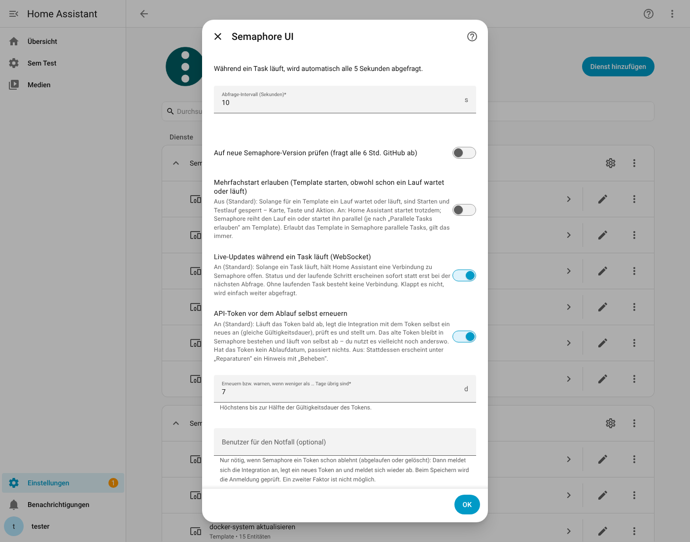

## Setup errors

If setup (or “Reconfigure” / “Re-authenticate”; German UI: „Neu konfigurieren“ / „Erneut authentifizieren“) fails, the **cause is shown directly in the
dialog** – you do not need the log: name cannot be resolved (DNS), connection refused (port), timeout,
certificate error, host unreachable, invalid address, “no Semaphore answers at this address” (with
HTTP status), rejected token (401), project not found. The token never appears in a message or in the log.

## Repairs (Settings → Repairs)

Problems that you need to fix are reported by the integration under **Settings → System → Repairs**. There is
at most one notice per kind per project, and it disappears by itself as soon as the problem is gone.

| Notice | When | What to do |
|---|---|---|
| **Semaphore: API token rejected** | immediately when Semaphore rejects the token (HTTP 401) and no stored login helps | **Fix**: enter a new token **or user name and password**. It is checked before it is saved; afterwards the integration reloads and the open “Re-authenticate” message is resolved. |
| **Semaphore: API token expires soon** | when the token expires in fewer than the configured number of days **and** automatic renewal is off | **Fix**: creates a new one with the current token, checks it and adopts it. |
| **Semaphore: API token could not be replaced** | when automatic renewal has failed (the reason is in the notice) | **Fix** tries again; otherwise create a token in Semaphore and enter it under “Re-authenticate”. |
| **Semaphore is not reachable** | when Semaphore has not answered for **10 minutes without interruption** (connection, timeout, HTTP 5xx, wrong response) | Check Semaphore, address, network and firewall. The notice names the reason and since when it has existed. A restart of Semaphore (a few seconds) triggers nothing. |
| **Semaphore project not found** | when the project returns HTTP 404/403 for **10 minutes** | Check the project in Semaphore and the token’s permissions; if the project was deleted, remove the entry. |

As long as a problem exists, the devices and entities of the project are “unavailable” (the schedules and runs in Semaphore
continue independently of that). The notices are not stored: after a restart of Home Assistant the
10 minutes start over, a rejected token is reported again immediately. If the entry is removed, its notices disappear as well.

## Symbol (icon)

`custom_components/semaphore_ui/brand/` contains the **Semaphore UI logo** ([semaphoreui.com](https://semaphoreui.com)). The
Semaphore UI project has allowed using it in this repository and in the HACS listing as long as it is clear that this is an
**unofficial community integration** and links to semaphoreui.com – both are stated at the top of this file. The logo belongs to the
Semaphore UI project (see `brand/LICENSE.txt`); the permission does not automatically extend to third parties who copy this
repository. Source: `brand/icon.svg`; Home Assistant 2026.10 loads `brand/icon.png` and `brand/icon@2x.png` straight from the integration.

## Token maintenance (expiry, renewal)

Since Semaphore 2.18.2, API tokens can have an **expiry date**. The integration reads it once per hour
(`GET /api/user/tokens`; it recognizes its own token by the first 8 characters) and displays it:

* **Sensor “API token valid until”** (German UI: „API-Token gültig bis“; diagnostic, on the project device, timestamp). Attributes: `token_found`, `token_name`, `created`,
  `never_expires`, `auto_renew`, `renew_days_before`, `stored_login`, `last_renewed`, `renew_error`. If the token has no expiry date
  (or Semaphore does not show the tokens), the sensor stays empty and nothing happens.
* **Renew automatically** (option, default on): If fewer than **7 days** remain (adjustable, at most half the lifetime),
  the integration creates a new token **using the token itself** (`POST /api/user/tokens`, same lifetime, name
  “Home Assistant (semaphore_ui)”), checks it with a request and then switches over. **No password needed.**
  The **old token is not deleted**: you may still use it elsewhere (`rest_command`, scripts), and it expires by itself.
  New tokens therefore accumulate in Semaphore (under “API tokens”); you can delete old ones there yourself at any time.
* **Renewal off:** Then the notice “API token expires soon” appears under *Repairs* with **Fix** (one click renews).
  If automatic renewal fails, the reason is in the notice “could not be replaced”.

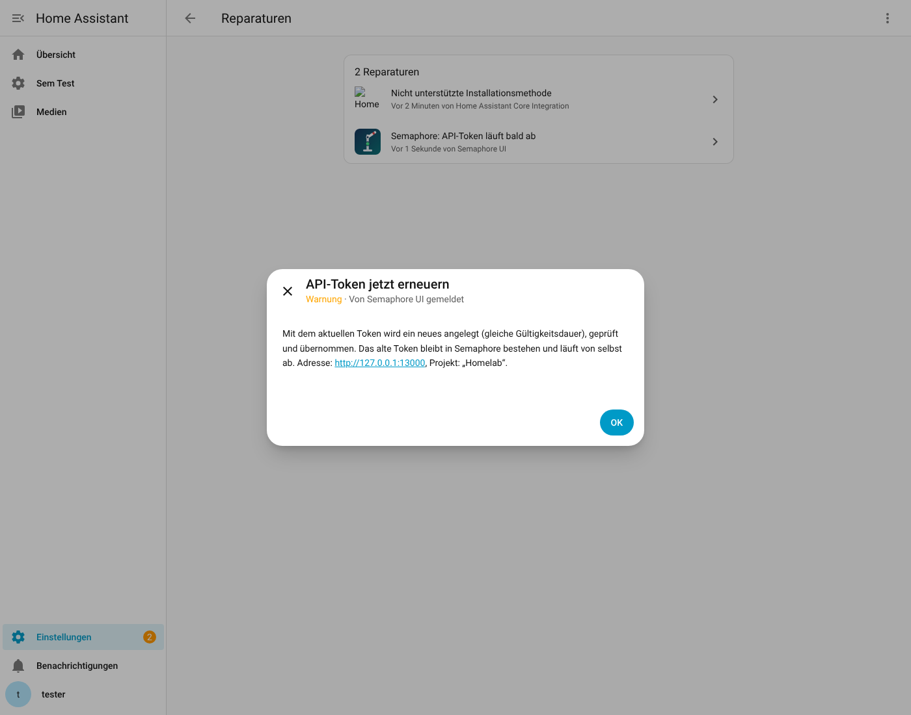

**In the project card:** When the end approaches (within the configured days, at most half the lifetime), a notice appears at the top:
“Token expires in 20 hours · will be renewed automatically” (orange) or “· renewal is off” / “· renewal failed: …” (red);
a click opens the sensor. If Semaphore is not reachable, the banner names the **reason** (token rejected, server not reachable with
the technical message, project not found) and links to the integration, where “Re-authenticate” or the repair is waiting.
For this, the “Available” sensor (German UI: „Verbindung“) has the attributes `reason` (`token_rejected`, `unreachable`, `project_missing`), `detail` and `config_entry_id`.

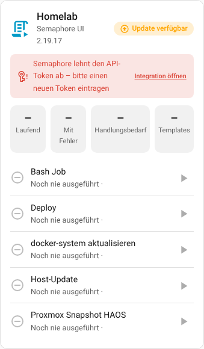

**Emergency login (optional):** A token that Semaphore **already rejects** (expired or deleted) can no longer be replaced using itself.
If you enter a user name and password in the options (or tick “Keep the user name and password to replace a rejected token by itself in future” during re-authentication;
German UI: „Benutzer und Passwort speichern“), the integration signs in in this case, creates a new token and **signs out again**.
The attempt is repeated at most every 10 minutes, so that a wrong password does not lock an account. Token and password are stored **encrypted**
(see “How securely are the token and password stored?” below; in diagnostics they are redacted). A user with a **second factor
(MFA)** does not work here. Without a stored login everything stays as before: the rejected token starts “Re-authenticate”,
and the notice “API token rejected” allows entering a new token or user name and password.

### How securely are the token and password stored?

Home Assistant has no password safe for integrations: what is entered in an integration is normally stored **in plain text** in
`.storage/core.config_entries` (even for the official integrations). This integration therefore encrypts the token and the optional
emergency password (Fernet: AES with checksum) with a random key that lives in a **separate file**:
`.storage/semaphore_ui.key` (readable only by the Home Assistant user).

- **Protected:** The configuration file alone – for example posted in a forum, in a partial copy or in a support package – reveals neither token nor password.
- **Not protected:** Anyone who gets the **whole `.storage` folder** or a complete backup including the key can decrypt everything – Home Assistant itself has to be able to read the key. Encrypted backups help against that.
- **Existing setups** are converted automatically on the first start after the update, without you having to do anything.
- **Key lost** (e.g. configuration restored without `semaphore_ui.key`): Home Assistant asks for a new token (“Re-authenticate”).
- When **changing the connection** (Reconfigure), the stored token is no longer displayed; leaving the field empty keeps it.

To change the URL, token or SSL check later: *Settings → Devices & services → Semaphore UI → ⋮ → Reconfigure*
(all devices, entities and history are kept).

## Logbook, diagnostics, cleanup

* **Logbook**: The start and end of every task appear in the logbook with the ready-made short text (e.g. “Semaphore – Host-Update:
  ❌ fehlgeschlagen · 18 s · …”).
* **Download diagnostics** (entry → ⋮ → *Download diagnostics*): state of the templates (and which are unticked), version (including the raw version
  reported by the server), interval and a section `frontend`: how the cards were registered (file, path, resource).
  Token and address are redacted, task outputs and notes are not included – safe for bug reports in the repo.
* **Clean up devices**: The device of a template deleted in Semaphore can be removed in Home Assistant via
  *Device → ⋮ → Delete device* (not the devices of existing templates and not the project device).

## Known limitations (beta)

* Templates of type *build/deploy* (with build version) cannot yet be started in a meaningful way.
* Double-start protection: That “Allow parallel tasks” on the template is in the field `allow_parallel_tasks` of the Semaphore API is an
  assumption from the API description and has not yet been verified against a real instance. If the template flag has no effect, the integration’s
  option “Allow starting again” helps. A run started in Semaphore blocks only after the next poll.
* Planned items and ideas are listed as [issues](../../issues) in the repository.
* Token renewal: tested against the API replica and a fresh Home Assistant, **not yet on a real instance with an
  expiring token** (the fields `expires_at`/`name` exist since Semaphore 2.18.2; `POST /api/user/tokens` with the token itself
  is derived from the source code). Please verify the first time with a short-lived token.
* Notes (`notes`) and package lists are truncated (10 notes of 200 characters each, 200 packages per run and host); the card reports missing packages as “n more packages not listed”, the rest stays in Semaphore’s log.
* Schedules: The integration only switches them on/off and displays them (creating and changing is done in Semaphore). The endpoint
  `…/schedules/<id>/active` was checked in the source code of Semaphore 2.19, tested against the replica and confirmed on a real instance
  (2.19.17) for **switching off**; switching on calls the same endpoint with `true`. If the token lacks the
  permission, the message says so.
  “Next run” is a calculation from the cron text and the time zone; daylight-saving changes and `@every` are only partly predictable.
* Survey: Multiple choice (*select*) and *secret* only via the action; sending the values follows what the
  Semaphore web interface does (`environment` or `secret` as JSON text in the task) – please test once with a
  variable that is output in your playbook.
* The automated tests run against a replica of the API that I built from the official specification and the
  Semaphore source code. First practical tests against Semaphore 2.19.17 (Docker) are underway; feedback from them has been incorporated in
  0.1.2. Please check new features first with a harmless template (dry run).

## Tests

```bash
python3.14 -m venv venv && source venv/bin/activate     # Home Assistant 2026.10 needs Python 3.14
pip install -r requirements_test.txt
pytest
```

* `tests/fake_semaphore.py` – small Semaphore replica (aiohttp) with projects, templates, tasks, log output, token check.
  Add new endpoints/cases here if the real API answers differently.
* `tests/test_report.py` – log parsing and report (pure functions, fast).
* `tests/test_survey.py` – survey logic (defaults, required fields, types) and input entities, restoration, action.
* `tests/test_flow_and_entities.py` – config flow, re-auth, options, devices/entities, buttons, action with waiting,
  events, removed/new templates, server not reachable.
* `tests/test_extras.py` – reconfigure, diagnostics (redaction), logbook, deleting devices, delivery of the card file
* `tests/test_ha_result.py` – `HA_RESULT` and failure reasons from **real Ansible logs** (`tests/fixtures/`, recorded with
  ansible-core 2.21 in the formats `yaml`/`json`: folded lines, `to_nice_json`, apostrophes/umlauts, multiple hosts, UNREACHABLE, `notes` hints).
* `tests/test_schedule.py` – cron evaluation as in Semaphore (`robfig/cron`): fields, names, step values, day/weekday rule,
  `TZ=` prefix, time zones, invalid expressions, one-time schedules (pure functions, without Home Assistant).
* `tests/test_schedules.py` – switches, “Next run”, time zone from Semaphore, errors when toggling, Semaphore without schedules,
  deleted/new schedules, recurrence after a restart, “Last success” (history is read only once per new run).
* `tests/test_filter.py` – option “Show templates in Home Assistant”: devices/entities/switches of unticked templates disappear
  and come back, new templates keep appearing, at least one remains, other options do not lose the selection,
  without a connection it is kept, identical names become distinguishable, diagnostics.
* `tests/test_ha_result.py` also contains the disk values per host (rounding, decimal comma, nonsense is ignored, percent above 100).
* `tests/test_repairs.py` – repairs: rejected token (immediately, Fix dialog with check, token without access, removed entry),
  outage only after 10 minutes (also across setup retries), short outage without notice, project gone (403/404), notices
  disappear on recovery and on removal, texts (placeholders in de/en).
* `tests/test_tokens.py` – token maintenance: reading expiry (sensor, no expiry, list not readable), renewing before expiry (window,
  half lifetime, new token is checked, old one stays), failure with notice, renewal off, emergency login (rejected token,
  wrong password is not retried constantly, MFA), forms (re-authenticate, repair, options), diagnostics without password.
* `tests/test_running_overview.py` – project sensors “Running tasks” / “Template running” name the running templates (also those started in Semaphore).
* `tests/test_parallel_guard.py` – double-start protection (blocked second start, simultaneous starts, dry run, option
  “Allow starting again”, template flag “Allow parallel tasks”, runs started in Semaphore, attributes of the Running sensor).
* `tests/test_action_needed.py` – action-needed entities (created only at the first report, stay after a restart, unknown
  without a report, retry on unreadable log), project counters, event, diagnostics, language.
* `tests/test_errors_versions_failures.py` – understandable errors in the setup dialog (DNS, port, SSL, wrong address, token),
  version comparison with build suffix, error attributes of the problem sensors, card resource (real Lovelace)
  (and that the integration keeps working without a web server/frontend), JavaScript syntax check (`node --check`, if Node is available).

### Browser test of the dashboard cards (optional, `tests/browser/`)

Starts the Semaphore replica and a **fresh Home Assistant** in a throwaway folder and checks the cards in a
real Chromium (Playwright): rendering, start/dry run/stop, confirmation, survey inputs including error message, narrow
screens/dark mode, English, card editor, **two projects** (Homelab/Testlab with identical template names),
card picker (“By card”), dashboard resource, the error texts in the setup dialog and the “Needs action” display
(including the “only what is needed” view), as well as numbers per host and notes, clickable rows, the **tile filters** and the
**version displays** of the project card, the **schedules** (switch acts on Semaphore, “Next run”, “Last success”), the **spinner** after the click
(switch, Start) and
the **token maintenance** (sensor, options, repair “Fix” creates a new token) and
the **images for this documentation**. Takes a good two minutes.

```bash
pip install playwright && playwright install chromium        # once
HA_PYTHON=venv/bin/python PW_PYTHON=venv/bin/python bash tests/browser/run_e2e.sh
```

**Documentation images** (`docs/screenshots/`): The run always generates them in the working folder (`shots/docs/`); with
`UPDATE_SCREENSHOTS=1 bash tests/browser/run_e2e.sh` they end up in `docs/screenshots/` – do this before a release and
commit them. Otherwise the images in the repo stay unchanged (they contain times and would differ with every run).

`KEEP=1` keeps the working folder (screenshots in `shots/`, logs `ha.log`, `fake.log`); on failures it is kept automatically.
Does not run under `pytest` (no `test_*.py`) and is not needed for normal test runs.

A failure pattern from practice (different Ansible log, different status)? Add the log excerpt as a new case in `tests/test_report.py`
and adapt `custom_components/semaphore_ui/report.py`.

## Structure

```
custom_components/semaphore_ui/
  api.py           REST client (bearer token)
  report.py        report + log parsing incl. HA_RESULT (no Home Assistant dependency)
  schedule.py      cron evaluation as in Semaphore, "next run" (no Home Assistant dependency)
  coordinator.py   polling, start/end detection, events, start/stop/wait; version coordinator
  config_flow.py   setup, re-auth, reconfigure, options (incl. template selection)
  issues.py        create and clean up repair notices (token, not reachable, project gone)
  tokens.py        token maintenance: read expiry, renew in time, emergency login (sensor, repair "expires soon")
  repairs.py       Fix dialogs: token rejected (enter token or login), renew token now
  survey.py        survey variables: defaults, required fields, types (no Home Assistant dependency)
  survey_entity.py · text.py · number.py · select.py   input entities of the survey variables
  sensor.py · binary_sensor.py · button.py · event.py · update.py · switch.py (schedules)
  cards.py         serves frontend/, has Home Assistant load the card file and registers it as a dashboard resource
  brand/           Semaphore UI logo (used with permission), icon.svg + icon.png + icon@2x.png
  frontend/semaphore-ui-card.js   template card, project card, card editor (plain JavaScript, no build step)
  diagnostics.py · logbook.py
  services.yaml · icons.json · translations/{de,en}.json
tests/browser/     optional browser test of the cards (see above)
docs/screenshots/  images of the cards for this README (generated by the browser test)
playbooks/        example playbook for HA_RESULT
```

Changing cards: edit only `frontend/semaphore-ui-card.js` – the file is served at startup with its modification date as
the version; after a restart and a browser reload the new version is active.
